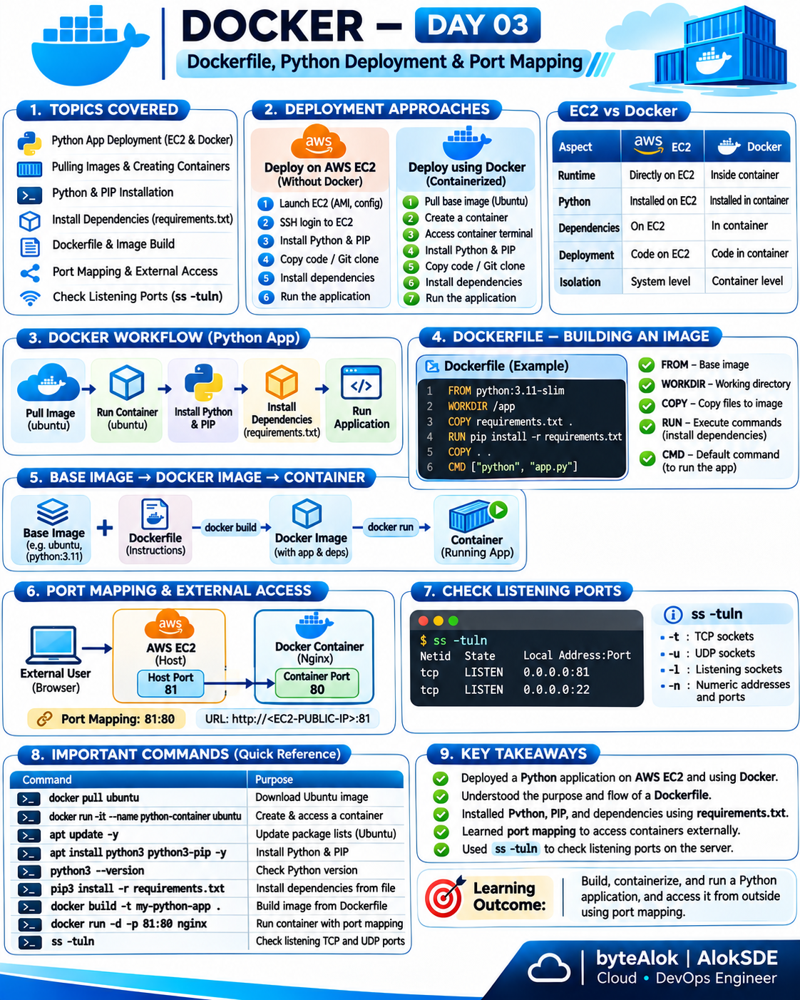

# 🐳 Day 03 – Dockerfile, Python Deployment & Port Mapping

> 🚀 Exploring Python application deployment using AWS EC2 and Docker, understanding Dockerfile, and accessing containers through port mapping.

<p align="center">
  
</p>

## 📚 Topics Covered

- ☁️ Python Application Deployment on AWS EC2
- 🐳 Python Application Deployment using Docker
- 📥 Pulling Ubuntu Docker Image
- 📦 Creating & Accessing Containers
- 🐍 Python & PIP Installation
- 📦 Installing Dependencies using `requirements.txt`
- 📄 Dockerfile Introduction
- 🖼️ Base Image to Docker Image
- 🌐 External Container Access
- 🔀 Docker Port Mapping
- 🔍 Checking Listening Ports using `ss -tuln`

---

## 1. ☁️ Python Application Deployment Process

There are different ways to deploy a Python application. In this session, we explored two approaches.

### ☁️ Approach 1: Deployment on AWS EC2

In this approach, we deploy the Python application directly on an EC2 server without using Docker.

**Deployment Steps:**

1. 🖥️ Create an EC2 server by selecting OS (AMI) and hardware configuration.
2. 🔑 Login to the EC2 server.
3. 🐍 Install the Python environment.
4. 📂 Copy application code or Git Clone.
5. 📦 Install required dependencies.
6. 🚀 Run the application.

### 🐳 Approach 2: Deployment using Docker

In this approach, we use a Docker container to provide an isolated environment for the Python application.

**Deployment Steps:**

1. 📥 Pull Ubuntu Docker image.
2. 📦 Create a container using the Ubuntu image.
3. 🔑 Login to the container.
4. 🐍 Install Python and PIP.
5. 📂 Copy application code or Git Clone.
6. 📦 Install required dependencies.
7. 🚀 Run the application.

### ⚖️ Deployment Approach Comparison

| AWS EC2 | Docker Container |
|---|---|
| Application runs directly on EC2 | Application runs inside a container |
| Python installed on EC2 | Python installed inside container |
| Dependencies installed on EC2 | Dependencies installed inside container |
| Code deployed on EC2 | Code deployed inside container |

---

## 2. 🐳 Docker Container Setup & Login

Before installing Python, we first need to create an Ubuntu container and access its terminal.

### 📥 Step 1: Pull Ubuntu Image

```bash
docker pull ubuntu
```

**📖 Definition:** Downloads the Ubuntu Docker image from Docker Hub to the local Docker environment.

**🔍 Why use it?**

We need an Ubuntu image to create an Ubuntu-based container.

**📤 Example Output:**

```text
Using default tag: latest
latest: Pulling from library/ubuntu
...
Status: Downloaded newer image for ubuntu:latest
```

### 📦 Step 2: Create Ubuntu Container

```bash
docker run -it ubuntu
```
OR
```bash
docker run -it --name python-container ubuntu
```

**📖 Definition:** Creates and starts a new container using the Ubuntu image and opens its interactive terminal.

**⚙️ Command Breakdown:**

| Part | Description |
|---|---|
| `docker run` | Creates and starts a container |
| `-i` | Keeps standard input open |
| `-t` | Allocates a pseudo-terminal |
| `--name` | Assigns a name to the container |
| `python-container` | Container name |
| `ubuntu` | Docker image name |

### 🔑 Step 3: Access Container Terminal

After executing the previous command, we enter the Ubuntu container directly.

**📤 Expected Terminal:**

```text
root@container-id:/#
```

Now we are inside the Ubuntu container and can execute Linux commands.

---

## 3. 🐍 Python & PIP Installation

After entering the Ubuntu container, we need to install Python and PIP.

### 🔄 Step 1: Update Package Lists

```bash
apt update -y
```

**📖 Definition:** Updates the local package index so that Ubuntu can access information about the latest available packages from configured repositories.

**🔍 Why use it?**

To refresh package information before installing Python packages.

### 📥 Step 2: Install Python & PIP

```bash
apt install python3 python3-pip -y
```

**📖 Definition:** Installs Python 3 and its PIP package installer inside the Ubuntu container.

**⚙️ Command Breakdown:**

| Part | Description |
|---|---|
| `apt` | Ubuntu package manager |
| `install` | Installs packages |
| `python3` | Python 3 interpreter |
| `python3-pip` | Python package installer |
| `-y` | Automatically confirms installation |

**🔍 Why use it?**

Python is required to execute the application, while PIP is used to install its external dependencies.

### ✅ Step 3: Verify Installation

```bash
python3 --version
pip3 --version
```

**📤 Example Output:**

```text
Python 3.x.x
pip x.x from ...
```

---

## 4. 📦 Install Dependencies using requirements.txt

Python applications often depend on external libraries and packages.

These dependencies are generally listed in a file named `requirements.txt`.

### 📥 Install Dependencies

```bash
pip3 install -r requirements.txt
```

**📖 Definition:**

The `requirements.txt` file contains a list of Python packages required by an application. PIP reads this file and installs the listed dependencies.

**⚙️ Command Breakdown:**

| Part | Description |
|---|---|
| `pip3` | Python 3 package installer |
| `install` | Installs packages |
| `-r` | Reads packages from a file |
| `requirements.txt` | Dependency list file |

**📄 Example requirements.txt:**

```text
flask
requests
numpy
```

**📤 Example Output:**

```text
Collecting flask
Collecting requests
Collecting numpy
Successfully installed ...
```

Actual output depends on the packages and their versions.

---

## 5. 📄 Dockerfile

**📖 Definition:**

A Dockerfile is a plain-text configuration file (with no file extension) that contains a sequential list of instructions used by Docker to automatically build a container image.

**🔍 Why use it?**

Dockerfile defines the instructions required to prepare an application environment and build a Docker image.

### 🔄 Docker Image Build Process

```text
       🖼️ Base Image
             |
             ▼
        📄 Dockerfile
             |
           Build
             |
             ▼
        📦 Docker Image
             |
             ▼
       🐍 Application
       ⚙️ Dependencies
       🖥️ OS Environment
```

### 📝 Understanding the Components

- 🖼️ **Base Image:** Provides the starting environment for building an image.
- 📄 **Dockerfile:** Contains sequential instructions.
- 📦 **Docker Image:** Created by following Dockerfile instructions.
- ⚙️ **Dependencies:** Required libraries and packages.
- 🐍 **Application:** Application code included in the resulting environment.

---

## 6. 🌐 Accessing Container from External

A Docker container can be accessed externally through port mapping.

For this purpose, Docker provides the `-p` option.

### 🚀 Run Nginx Container with Port Mapping

```bash
docker run -dt -p 81:80 nginx
```

**📖 Definition:**

Port mapping connects a port on the Docker host to a port inside the container.

It allows external users to access an application running inside a container through the host's mapped port.

### ⚙️ Command Breakdown

| Part | Description |
|---|---|
| `docker run` | Creates and starts a container |
| `-d` | Detached mode |
| `-t` | Allocates a pseudo-terminal |
| `-p` | Maps host and container ports |
| `81` | Host port (EC2 port) |
| `80` | Container port |
| `nginx` | Docker image name |

### 🔀 Understanding Port Mapping

```text
        🌐 External User
               |
               ▼
        ☁️ AWS EC2 Server
               |
          Host Port 81
               |
               ▼
        🐳 Docker Container
               |
        Container Port 80
               |
               ▼
             Nginx
```

**📌 Port Forwarding:**

```text
EC2 Host Port 81  ──────►  Container Port 80
```

**💡 Example URL:**

```text
http://EC2-PUBLIC-IP:81
```

When an external user accesses the EC2 public IP on port 81, Docker forwards the request to port 80 inside the Nginx container.

**⚠️ Important:** The EC2 Security Group must allow inbound TCP traffic on port 81 for external access.

---

## 7. 🔍 Checking Listening Ports – ss -tuln

```bash
ss -tuln
```

**📖 Definition:**

The `ss` command displays socket information. With these options, it helps identify TCP and UDP ports that are currently listening on the system.

### ⚙️ Command Breakdown

| Option | Description |
|---|---|
| `ss` | Socket statistics command |
| `-t` | Displays TCP sockets |
| `-u` | Displays UDP sockets |
| `-l` | Displays listening sockets |
| `-n` | Displays numeric addresses and port numbers |

**📤 Example Output:**

```text
Netid  State   Local Address:Port
tcp    LISTEN  0.0.0.0:81
tcp    LISTEN  0.0.0.0:22
```

**🔍 Why use it?**

- 🔎 Check listening TCP ports.
- 🔎 Check listening UDP ports.
- 🌐 Identify which ports are listening on the server.
- 📋 Verify port listening status.

---

## 📌 Quick Command Reference

| Command | Purpose |
|---|---|
| `docker pull ubuntu` | Download Ubuntu image |
| `docker run -it ubuntu` | Automatically generated name |
| `docker run -it --name python-container ubuntu` | Create and access container |
| `apt update` | Update package lists |
| `apt install python3 python3-pip -y` | Install Python and PIP |
| `python3 --version` | Check Python version |
| `pip3 --version` | Check PIP version |
| `pip3 install -r requirements.txt` | Install Python dependencies |
| `docker run -dt -p 81:80 nginx` | Run Nginx with port mapping |
| `ss -tuln` | Check listening TCP and UDP ports |

---

## 🎯 Learning Outcomes

After completing Day 03, I understood:

- ☁️ Python application deployment on AWS EC2.
- 🐳 Python application deployment inside Docker containers.
- 📥 Pulling Ubuntu images and creating containers.
- 🔑 Accessing an Ubuntu container terminal.
- 🐍 Installing Python and PIP using APT.
- 📦 Installing dependencies using `requirements.txt`.
- 📄 Dockerfile and its purpose.
- 🖼️ Base Image to Docker Image build process.
- 🌐 External access to Docker containers.
- 🔀 Host port and container port mapping.
- 🔍 Checking listening ports using `ss -tuln`.

---

## 🤝 Let's Connect

👨‍💻 **GitHub:** [@byteAlok](https://github.com/byteAlok)

🌐 **Portfolio:** [aloksde.com](https://aloksde.com)

⭐ If you find these notes helpful, consider giving this repository a Star. It motivates me to keep learning, documenting, and sharing practical knowledge.

**Thanks for visiting! Happy Learning & Keep Building! 🚀**
