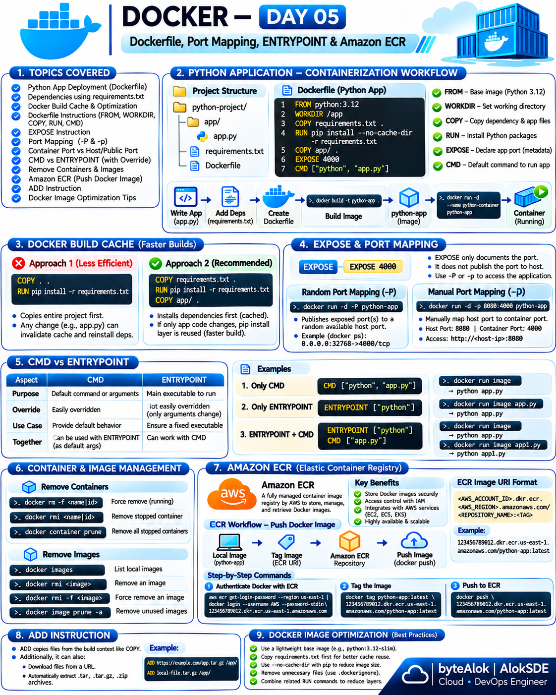

# 🐳 Day 05 – Dockerfile, Port Mapping, ENTRYPOINT & Amazon ECR

> 🚀 Learning how to containerize a Python application, optimize Docker image builds, understand CMD vs ENTRYPOINT, manage containers and images, and push Docker images to Amazon ECR.

<p align="center">
  
</p>

## 📚 Topics Covered

- 🐍 Python Application Deployment using Dockerfile
- 📦 Python Dependencies using `requirements.txt`
- ⚡ Docker Build Cache
- 📂 Dockerfile Instructions – `FROM`, `WORKDIR`, `COPY`, `RUN`, `CMD`
- 🌐 EXPOSE Instruction
- 🔀 Random Port Mapping using `-P`
- 🎯 Manual Port Mapping using `-p`
- 🔌 Container Port vs Host/Public Port
- ⚖️ CMD vs ENTRYPOINT
- 🔄 Overriding CMD and ENTRYPOINT
- 🗑️ Remove Containers
- 🧹 Remove Docker Images
- ☁️ Amazon Elastic Container Registry (ECR)
- 🏷️ Docker Image Tagging for Remote Repositories
- 📤 Push Docker Images to Amazon ECR
- 📥 ADD Instruction
- 🚀 Docker Image Optimization

---

## 1. 🐍 Python Application Deployment using Dockerfile

In this practical, we will create a Docker image for a Python application and run it inside a Docker container.

### 📂 Project Structure

```text
python-project/
│
├── app/
│   └── app.py
│
├── requirements.txt
└── Dockerfile
```

**File Description:**

| File | Purpose |
|---|---|
| `app/` | Contains application files |
| `app.py` | Main Python application |
| `requirements.txt` | Contains Python dependencies |
| `Dockerfile` | Contains Docker image build instructions |

### 📝 Step 1: Create Python Application

Create `app.py` inside the `app` directory.

```python
print("Hello from Docker!")
```

**Definition:** `app.py` is the Python application file that we want to execute inside the container.

### 📝 Step 2: Create requirements.txt

```text
flask
requests
```

**Definition:** `requirements.txt` contains the Python packages required by our application.

**Why use it?**

Instead of installing Python packages individually, we can specify all required dependencies in one file.

**Installation command:**

```bash
pip install -r requirements.txt
```

**Command Breakdown:**

| Part | Description |
|---|---|
| `pip` | Python package installer |
| `install` | Installs packages |
| `-r` | Reads package names from a requirements file |
| `requirements.txt` | File containing dependencies |

### 📝 Step 3: Create Dockerfile

```dockerfile
FROM python:3.12

WORKDIR /app

COPY requirements.txt .

RUN pip install --no-cache-dir -r requirements.txt

COPY app/ .

CMD ["python", "app.py"]
```

### 🔍 Dockerfile Explanation

**1. FROM**

```dockerfile
FROM python:3.12
```

- Selects Python 3.12 as the base image.
- The Python image already provides the Python runtime and required environment.

**2. WORKDIR**

```dockerfile
WORKDIR /app
```

- Sets `/app` as the working directory inside the image.
- Subsequent instructions use this directory as their working directory.

**3. COPY requirements.txt**

```dockerfile
COPY requirements.txt .
```

- Copies `requirements.txt` from the build context into `/app`.
- `.` represents the current working directory inside the image, which is `/app`.

**4. RUN**

```dockerfile
RUN pip install --no-cache-dir -r requirements.txt
```

- Installs the dependencies listed in `requirements.txt`.
- `-r` reads the requirements file.
- `--no-cache-dir` prevents pip from retaining its package download cache inside the image.

**5. COPY Application**

```dockerfile
COPY app/ .
```

- Copies the contents of the local `app/` directory into the container image's `/app` directory.
- Our `app.py` becomes `/app/app.py`.

**6. CMD**

```dockerfile
CMD ["python", "app.py"]
```

- Defines the default command when the container starts.
- Executes the Python application.

### 🏗️ Step 4: Build Docker Image

```bash
docker build -t python-app .
```

**Explanation:**

- `docker build` → Builds a Docker image.
- `-t python-app` → Assigns the image name.
- `.` → Specifies the current directory as the build context.

### 🚀 Step 5: Run Container

```bash
docker run -d --name python-container python-app
```

**Explanation:**

- `docker run` → Creates and starts a container.
- `-d` → Runs the container in detached mode.
- `--name python-container` → Assigns a custom container name.
- `python-app` → Specifies the image used to create the container.

### 📋 Verify Container

```bash
docker ps -a
```

### 📜 Check Application Output

```bash
docker logs python-container
```

**Expected Output:**

```text
Hello from Docker!
```

---

## 2. ⚡ Docker Build Cache & Dependency Installation

Docker uses a build cache to avoid executing unchanged build instructions again.

This helps reduce image build time.

### 🔴 Approach 1: Copy Everything Before Installing Dependencies

```dockerfile
FROM python:3.12

WORKDIR /app

COPY . .

RUN pip install --no-cache-dir -r requirements.txt

CMD ["python", "app.py"]
```

**Problem:**

Suppose we make a small change in `app.py` and build the image again.

Because `COPY . .` copies the entire project, a change in any copied file can invalidate the cache for that instruction and subsequent instructions.

As a result, Docker may execute the dependency installation step again.

### 🟢 Approach 2: Copy requirements.txt Separately

```dockerfile
FROM python:3.12

WORKDIR /app

COPY requirements.txt .

RUN pip install --no-cache-dir -r requirements.txt

COPY app/ .

CMD ["python", "app.py"]
```

**Why is this better?**

- First, Docker copies only `requirements.txt`.
- Then, Docker installs the dependencies.
- After that, Docker copies the application files.
- If only `app.py` changes, the requirements file remains unchanged.
- Docker can reuse the cached dependency installation layer.

### 🔍 Understanding Docker Build Cache

```text
        📄 requirements.txt
                 |
                 ▼
        📦 COPY requirements.txt
                 |
                 ▼
        ⚙️ RUN pip install
                 |
                 ▼
           📂 COPY app/
                 |
                 ▼
           🚀 CMD python app.py
```

### 📌 Example Scenarios

| Change | Dependency Installation |
|---|---|
| Only `app.py` changes | Cached layer can be reused |
| `requirements.txt` changes | Dependency installation runs again |
| Previous build cache is unavailable | Required steps execute again |

**💡 Important:**

Docker cache is based on build instructions and their relevant inputs. If an instruction or its inputs change, Docker may need to rebuild that instruction and subsequent layers.

**Remember:**

Keep dependency installation before copying frequently changing application files to improve build-cache reuse.

---

## 3. 🌐 EXPOSE Instruction

### 📝 Syntax

```dockerfile
EXPOSE port_number
```

### 💻 Example

```dockerfile
FROM python:3.12

WORKDIR /app

COPY requirements.txt .

RUN pip install --no-cache-dir -r requirements.txt

COPY app/ .

EXPOSE 4000

CMD ["python", "app.py"]
```

**Definition:**

`EXPOSE` documents the port on which the application inside the container is expected to listen.

### 🔍 Example

```dockerfile
EXPOSE 4000
```

Here:

- `EXPOSE` → Dockerfile instruction.
- `4000` → Application's container port.

**💡 Important:**

`EXPOSE` is only informational metadata. It does not automatically publish the port to the host machine.

To access the application from outside the container, we need port mapping using `-p` or `-P`.

---

## 4. 🔀 Random Port Mapping using -P

### 📝 Syntax

```bash
docker run -d -P image_name
```

**Definition:**

Uppercase `-P` publishes all ports exposed by the image to randomly assigned available host ports.

### 💻 Example

```bash
docker run -d -P python-app
```

**Command Breakdown:**

| Part | Description |
|---|---|
| `docker run` | Creates and starts a container |
| `-d` | Runs container in detached mode |
| `-P` | Publishes exposed container ports using random host ports |
| `python-app` | Docker image name |

### 🔍 How It Works

Suppose the Dockerfile contains:

```dockerfile
EXPOSE 4000
```

When we execute:

```bash
docker run -d -P python-app
```

Docker can assign a random available host port to the exposed container port.

**Example Port Mapping:**

```text
       🌐 Host Machine
       Public Port: 32768
                |
                |
                ▼
       🐳 Docker Container
       Application Port: 4000
```

**Example Output:**

```bash
docker ps
```

```text
CONTAINER ID   IMAGE        PORTS
abc123         python-app   0.0.0.0:32768->4000/tcp
```

Here:

- `32768` → Randomly assigned host port.
- `4000` → Container port.

**💡 Important:**

- `-P` is uppercase.
- Docker chooses the host port automatically.
- The container port comes from the image's exposed ports.
- The assigned host port can be different for different containers.

---

## 5. 🎯 Manual Port Mapping using -p

### 📝 Syntax

```bash
docker run -d -p host_port:container_port image_name
```

**Definition:**

Lowercase `-p` allows us to manually specify which host port should map to which container port.

### 💻 Example

```bash
docker run -d -p 8080:4000 python-app
```

**Command Breakdown:**

| Part | Description |
|---|---|
| `docker run` | Creates and starts a container |
| `-d` | Runs container in detached mode |
| `-p` | Manually maps host and container ports |
| `8080` | Host port |
| `4000` | Container port |
| `python-app` | Image name |

### 🔍 How It Works

```text
       🌐 Host Machine
       Public Port: 8080
                |
                |
                ▼
       🐳 Docker Container
       Application Port: 4000
```

The host receives connections on port `8080` and forwards them to port `4000` inside the container.

### 📤 Verify Port Mapping

```bash
docker ps
```

**Example Output:**

```text
CONTAINER ID   IMAGE        PORTS
abc123         python-app   0.0.0.0:8080->4000/tcp
```

### ⚖️ Difference Between -P and -p

| Uppercase `-P` | Lowercase `-p` |
|---|---|
| Random host port assignment | Manual host port assignment |
| Uses exposed container ports | Specifies host and container ports |
| Example: `-P` | Example: `-p 8080:4000` |

**💡 Remember:**

- `-P` → Random host port.
- `-p` → Manually assigned host port.

### 🔌 Container Port vs Host/Public Port

| Container Port | Host/Public Port |
|---|---|
| Port inside the container | Port on the host machine |
| Used by the application inside the container | Used to access the application from outside |
| Example: `4000` | Example: `8080` |

**Example:**

```bash
docker run -d -p 8080:4000 python-app
```

- Container port → `4000`
- Host port → `8080`

**📌 Important for AWS EC2:**

If the Docker container runs on an EC2 instance and we want to access the application externally:

1. Docker must publish the container port to a host port.
2. The EC2 Security Group must allow inbound traffic on that host port.
3. The application inside the container must listen on the appropriate interface and port.

---

## 6. ⚖️ CMD vs ENTRYPOINT

Both `CMD` and `ENTRYPOINT` define instructions that execute when a container starts.

Neither instruction executes during the Docker image build process.

### 🔹 CMD

`CMD` defines the default command or arguments for the container.

**Example:**

```dockerfile
FROM python:3.12

WORKDIR /app

COPY app/ .

CMD ["python", "app.py"]
```

When we run:

```bash
docker run python-app
```

Docker executes:

```bash
python app.py
```

### 🔹 ENTRYPOINT

`ENTRYPOINT` defines the main executable that runs when the container starts.

**Example:**

```dockerfile
FROM python:3.12

WORKDIR /app

COPY app/ .

ENTRYPOINT ["python"]
```

When we run:

```bash
docker run python-app app.py
```

Docker executes:

```bash
python app.py
```

### ⚖️ CMD vs ENTRYPOINT Difference

| CMD | ENTRYPOINT |
|---|---|
| Defines default command or arguments | Defines the main executable |
| Can be overridden by a command supplied to `docker run` | Normally remains the main executable |
| Useful for default container behaviour | Useful when a container should always run a particular executable |
| Can provide default arguments to ENTRYPOINT | Can work together with CMD |

### 📌 Case 1: CMD Override

**Dockerfile:**

```dockerfile
FROM python:3.12

WORKDIR /app

COPY app/ .

CMD ["python", "app.py"]
```

**Normal execution:**

```bash
docker run python-app
```

Docker executes:

```bash
python app.py
```

**Override CMD:**

```bash
docker run python-app python app1.py
```

Docker executes:

```bash
python app1.py
```

**Explanation:**

The command supplied after the image name replaces the default CMD instruction.

### 📌 Case 2: ENTRYPOINT

**Dockerfile:**

```dockerfile
FROM python:3.12

WORKDIR /app

COPY app/ .

ENTRYPOINT ["python"]
```

**Execution:**

```bash
docker run python-app app1.py
```

Docker executes:

```bash
python app1.py
```

**Explanation:**

- `ENTRYPOINT` specifies `python` as the executable.
- `app1.py` is passed as its argument.
- The argument supplied after the image name is appended to the ENTRYPOINT executable.

### 📌 Case 3: ENTRYPOINT + CMD

We can also use both instructions together.

**Dockerfile:**

```dockerfile
FROM python:3.12

WORKDIR /app

COPY app/ .

ENTRYPOINT ["python"]

CMD ["app.py"]
```

**Normal execution:**

```bash
docker run python-app
```

Docker executes:

```bash
python app.py
```

**Override Default CMD Arguments:**

```bash
docker run python-app app1.py
```

Docker executes:

```bash
python app1.py
```

**Explanation:**

- `ENTRYPOINT` defines the executable.
- `CMD` provides default arguments to that executable.
- Arguments supplied through `docker run` replace the default CMD arguments.

### 📊 Execution Summary

| Dockerfile | docker run | Effective command |
|---|---|---|
| `CMD ["python","app.py"]` | `docker run image` | `python app.py` |
| `CMD ["python","app.py"]` | `docker run image python app1.py` | `python app1.py` |
| `ENTRYPOINT ["python"]` | `docker run image app1.py` | `python app1.py` |
| `ENTRYPOINT ["python"]` + `CMD ["app.py"]` | `docker run image` | `python app.py` |
| `ENTRYPOINT ["python"]` + `CMD ["app.py"]` | `docker run image app1.py` | `python app1.py` |

**💡 Remember:**

- `CMD` → Default command or arguments.
- `ENTRYPOINT` → Main executable.
- Both can be used together.

---

## 7. 🗑️ Remove Containers

Docker provides different commands to remove running and stopped containers.

### 🔴 Remove a Running Container

**Command:**

```bash
docker rm -f <container_name_or_id>
```

**Definition:** Removes a container forcefully, including when it is running.

**Example:**

```bash
docker rm -f python-container
```

**Explanation:**

- `docker rm` → Removes a container.
- `-f` → Forcefully stops and removes the running container.
- `python-container` → Container name.

### 🟡 Remove a Stopped Container

**Command:**

```bash
docker rm <container_name_or_id>
```

**Example:**

```bash
docker rm python-container
```

**Definition:** Removes a stopped container.

**Important:** A running container normally cannot be removed with `docker rm` unless force removal is requested.

### 🧹 Remove All Stopped Containers

**Command:**

```bash
docker container prune
```

**Definition:** Removes all stopped containers from the Docker host.

**Confirmation:**

Docker asks for confirmation before removing stopped containers.

**💡 Important:**

This command does not remove running containers.

### 📌 Quick Reference

| Command | Purpose |
|---|---|
| `docker rm -f <name_or_id>` | Forcefully remove a running container |
| `docker rm <name_or_id>` | Remove a stopped container |
| `docker container prune` | Remove all stopped containers |

---

## 8. 🧹 Remove Docker Images

Docker images can be removed when they are no longer required.

### 📋 List Images

```bash
docker images
```

**Definition:** Displays Docker images available in local image storage.

### 🗑️ Remove an Image

**Command:**

```bash
docker rmi <image_name_or_id>
```

**Example:**

```bash
docker rmi python-app
```

**Definition:** Removes the specified Docker image.

### 🔴 Forcefully Remove an Image

**Command:**

```bash
docker rmi -f <image_name_or_id>
```

**Example:**

```bash
docker rmi -f python-app
```

**Definition:** Forcefully removes the specified image.

### 🧹 Remove Unused Images

**Command:**

```bash
docker image prune -a
```

**Definition:** Removes images that are not referenced by any container.

Docker asks for confirmation before removing them.

### 📌 Quick Reference

| Command | Purpose |
|---|---|
| `docker images` | List local images |
| `docker rmi <image_name_or_id>` | Remove an image |
| `docker rmi -f <image_name_or_id>` | Forcefully remove an image |
| `docker image prune -a` | Remove unused images |

**⚠️ Important:**

- An image used by an existing container may not be removable normally.
- Remove dependent containers first when required.
- `docker image prune -a` can remove many unused images, so review before confirming.
- Removing a container and removing its image are two different operations.

---

## 9. ☁️ Amazon ECR – Elastic Container Registry

<text>Amazon ECR (Elastic Container Registry) is a fully managed container image registry provided by AWS.</text>

It allows us to store, manage, and retrieve Docker container images.

### 💡 Why use Amazon ECR?

- 📦 Store Docker images in AWS.
- 🔐 Manage access through AWS IAM permissions.
- ☁️ Keep application images in an AWS-managed registry.
- 🚀 Pull images for deployment on AWS services.

### 🔍 Basic ECR Workflow

```text
        🐳 Local Docker Image
                 |
                 ▼
          🏷️ Docker Tag
                 |
                 ▼
        ☁️ Amazon ECR Repository
                 |
                 ▼
            📤 Docker Push
                 |
                 ▼
        ☁️ Image Stored in ECR
```

### 📌 Step 1: Create an ECR Repository

Open AWS Console:

1. Navigate to Amazon ECR.
2. Open Private Registry.
3. Select Repositories.
4. Click Create repository.
5. Enter a repository name.
6. Create the repository.

**Example Repository Name:**

```text
python-app
```

**Important:** In this practical, we will keep the local image name and ECR repository name the same for easier identification. They do not have to be identical technically.

### 📌 Step 2: Understand ECR Image URI

An ECR image URI follows this format:

```text
<AWS_ACCOUNT_ID>.dkr.ecr.<AWS_REGION>.amazonaws.com/<REPOSITORY_NAME>:<TAG>
```

**Example:**

```text
123456789012.dkr.ecr.us-east-1.amazonaws.com/python-app:latest
```

| Component | Meaning |
|---|---|
| `123456789012` | AWS Account ID |
| `dkr.ecr` | Amazon ECR registry endpoint |
| `us-east-1` | AWS Region |
| `python-app` | ECR repository name |
| `latest` | Image tag |

### 📌 Step 3: Authenticate Docker with Amazon ECR

Before pushing an image, Docker needs to authenticate with the ECR registry.

**Command:**

```bash
aws ecr get-login-password --region us-east-1 | docker login --username AWS --password-stdin 123456789012.dkr.ecr.us-east-1.amazonaws.com
```

**Command Breakdown:**

| Part | Description |
|---|---|
| `aws ecr get-login-password` | Retrieves an ECR authentication password |
| `--region us-east-1` | Specifies the AWS Region |
| `|` | Sends the command output to the next command |
| `docker login` | Authenticates Docker with the registry |
| `--username AWS` | Uses AWS as the registry username |
| `--password-stdin` | Reads the password from standard input |
| Registry URL | Specifies the ECR registry |

**Expected Output:**

```text
Login Succeeded
```

**Important Requirements:**

- AWS CLI must be installed.
- AWS credentials must be configured.
- The IAM identity must have the required ECR permissions.
- The ECR repository must exist before pushing the image.

### 📌 Step 4: Build Local Docker Image

```bash
docker build -t python-app .
```

This creates a local Docker image named `python-app`.

### 📌 Step 5: Tag the Image for ECR

**Syntax:**

```bash
docker tag <local_image_name> <remote_image_uri>
```

**Example:**

```bash
docker tag python-app:latest 123456789012.dkr.ecr.us-east-1.amazonaws.com/python-app:latest
```

**Definition:** `docker tag` creates another reference to an existing local image using a new image name and tag.

**Command Breakdown:**

| Part | Description |
|---|---|
| `docker tag` | Tags an existing image |
| `python-app:latest` | Existing local image |
| ECR registry URL | Destination registry |
| `python-app` | Remote repository name |
| `latest` | Remote image tag |

**💡 Important:**

Tagging does not upload the image. It prepares the image reference for pushing to the remote registry.

### 📌 Step 6: Push Image to Amazon ECR

**Syntax:**

```bash
docker push <remote_image_uri>
```

**Example:**

```bash
docker push 123456789012.dkr.ecr.us-east-1.amazonaws.com/python-app:latest
```

**Definition:** `docker push` uploads the locally available image to the specified remote registry.

**Expected Result:**

Docker uploads the image layers to Amazon ECR.

### 📌 Step 7: Verify Image in ECR

1. Open AWS Console.
2. Navigate to Amazon ECR.
3. Select the `python-app` repository.
4. Open the Images section.
5. Verify that the `latest` image tag is available.

### 📊 Complete ECR Command Reference

```bash
# Authenticate Docker with Amazon ECR
aws ecr get-login-password --region us-east-1 | docker login --username AWS --password-stdin 123456789012.dkr.ecr.us-east-1.amazonaws.com

# Build local Docker image
docker build -t python-app .

# Tag image for ECR
docker tag python-app:latest 123456789012.dkr.ecr.us-east-1.amazonaws.com/python-app:latest

# Push image to ECR
docker push 123456789012.dkr.ecr.us-east-1.amazonaws.com/python-app:latest
```

**⚠️ Replace these example values with your own:**

- `123456789012` → Your AWS Account ID.
- `us-east-1` → Your ECR repository's AWS Region.
- `python-app` → Your ECR repository name.

---

## 10. 📥 ADD Instruction

### 📝 Syntax

```dockerfile
ADD source destination
```

### 💻 Example

```dockerfile
FROM ubuntu

WORKDIR /app

ADD app.tar.gz /app/
```

**Definition:**

`ADD` copies files and directories into the Docker image. It also supports certain additional behaviours, such as extracting local tar archives and downloading files from URLs.

### 🔍 COPY vs ADD

| COPY | ADD |
|---|---|
| Copies files and directories | Copies files and directories |
| Does not automatically extract local archives | Automatically extracts supported local tar archives |
| Does not download remote URLs | Supports downloading files from URLs |
| Simpler and more predictable | Provides additional functionality |

### 📌 Example: Copy Local Files

```dockerfile
ADD app.py /app/
```

This copies `app.py` into `/app/`.

### 📌 Example: Extract a Local Archive

```dockerfile
ADD app.tar.gz /app/
```

Docker automatically extracts a supported local tar archive into `/app/`.

### 📌 Example: Download a Remote File

```dockerfile
ADD https://example.com/file.txt /app/file.txt
```

This downloads the remote file into the image at `/app/file.txt`.

**💡 Important:**

- `ADD` can download files from URLs.
- `ADD` does not directly clone a GitHub repository.
- For normal file copying, `COPY` is generally preferred.
- Use `ADD` when its additional functionality is actually needed.

---

## 11. 🚀 Docker Image Optimization

Docker image optimization means reducing unnecessary image size and improving image build efficiency.

### 💡 Why Optimize Docker Images?

- 📦 Reduce image size.
- ⚡ Improve image build time.
- 🚀 Speed up image transfer and deployment.
- 🧹 Avoid unnecessary files and dependencies.

### 📌 Optimization 1: Use a Suitable Base Image

Choose a base image that contains only the environment and runtime required by the application.

**Example:**

```dockerfile
FROM python:3.12-slim
```

`python:3.12-slim` is a smaller Python image variant compared with the standard full Python image.

### 📌 Optimization 2: Install Only Required Dependencies

Avoid installing unnecessary packages.

**Example:**

```dockerfile
RUN pip install --no-cache-dir -r requirements.txt
```

`--no-cache-dir` prevents pip from storing its download cache in the image.

### 📌 Optimization 3: Use Docker Build Cache

Copy dependency files before application source code.

```dockerfile
COPY requirements.txt .

RUN pip install --no-cache-dir -r requirements.txt

COPY app/ .
```

This allows Docker to reuse the dependency installation layer when only application source files change.

### 📌 Optimization 4: Combine Related RUN Commands

**Example:**

```dockerfile
RUN apt-get update && apt-get install -y python3 python3-pip
```

Combining related package operations in a single `RUN` instruction avoids creating a separate layer for each command.

### 📌 Optimization 5: Avoid Unnecessary Files

Do not include unnecessary files in the Docker build context.

A `.dockerignore` file can exclude files and directories from the build context.

**Example `.dockerignore`:**

```text
.git
__pycache__
*.pyc
.env
venv/
```

**💡 Important:** `.dockerignore` helps prevent unnecessary files from being sent as part of the build context.

---

## 📌 Quick Command Reference

| Command | Purpose |
|---|---|
| `docker build -t python-app .` | Build Python application image |
| `docker run -d --name python-container python-app` | Run container in detached mode |
| `docker logs python-container` | View application logs |
| `docker run -d -P python-app` | Publish exposed ports using random host ports |
| `docker run -d -p 8080:4000 python-app` | Manually map host port 8080 to container port 4000 |
| `docker ps` | List running containers |
| `docker rm -f <name_or_id>` | Forcefully remove a running container |
| `docker rm <name_or_id>` | Remove a stopped container |
| `docker container prune` | Remove all stopped containers |
| `docker images` | List local images |
| `docker rmi <image_name_or_id>` | Remove an image |
| `docker rmi -f <image_name_or_id>` | Forcefully remove an image |
| `docker image prune -a` | Remove unused images |
| `docker tag <local_image> <remote_image_uri>` | Tag image for remote registry |
| `docker push <remote_image_uri>` | Push image to remote registry |

---

## 🎯 Learning Outcomes

After completing Day 05, I understood:

- 🐍 How to containerize a Python application using Dockerfile.
- 📦 How to manage Python dependencies using `requirements.txt`.
- ⚡ How Docker build cache works.
- 🔄 Why copying requirements before application files improves cache reuse.
- 🌐 How to use the `EXPOSE` instruction.
- 🔀 Difference between uppercase `-P` and lowercase `-p`.
- 🎯 How to assign random and manual host ports.
- 🔌 Difference between container ports and host/public ports.
- ⚖️ Difference between `CMD` and `ENTRYPOINT`.
- 🔄 How to override CMD and ENTRYPOINT arguments.
- 🗑️ How to remove running and stopped containers.
- 🧹 How to remove Docker images.
- ☁️ What Amazon ECR is and why it is used.
- 🏷️ How to tag local Docker images for ECR.
- 📤 How to authenticate Docker and push images to Amazon ECR.
- 📥 Difference between `COPY` and `ADD`.
- 🚀 Basic Docker image optimization techniques.

---

## 🤝 Let's Connect

👨‍💻 **GitHub:** [@byteAlok](https://github.com/byteAlok)

🌐 **Portfolio:** [aloksde.com](https://aloksde.com)

⭐ If you find these notes helpful, consider giving this repository a Star. It motivates me to keep learning, documenting, and sharing practical knowledge.

**Thanks for visiting! Happy Learning & Keep Building! 🚀**
