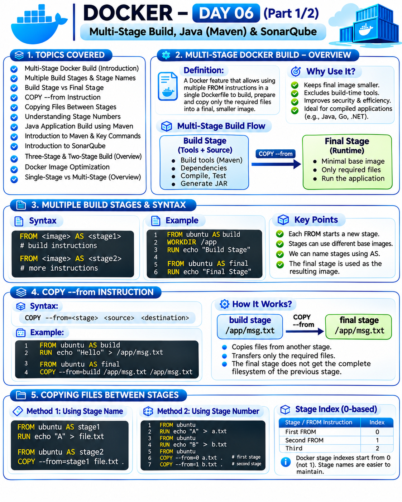
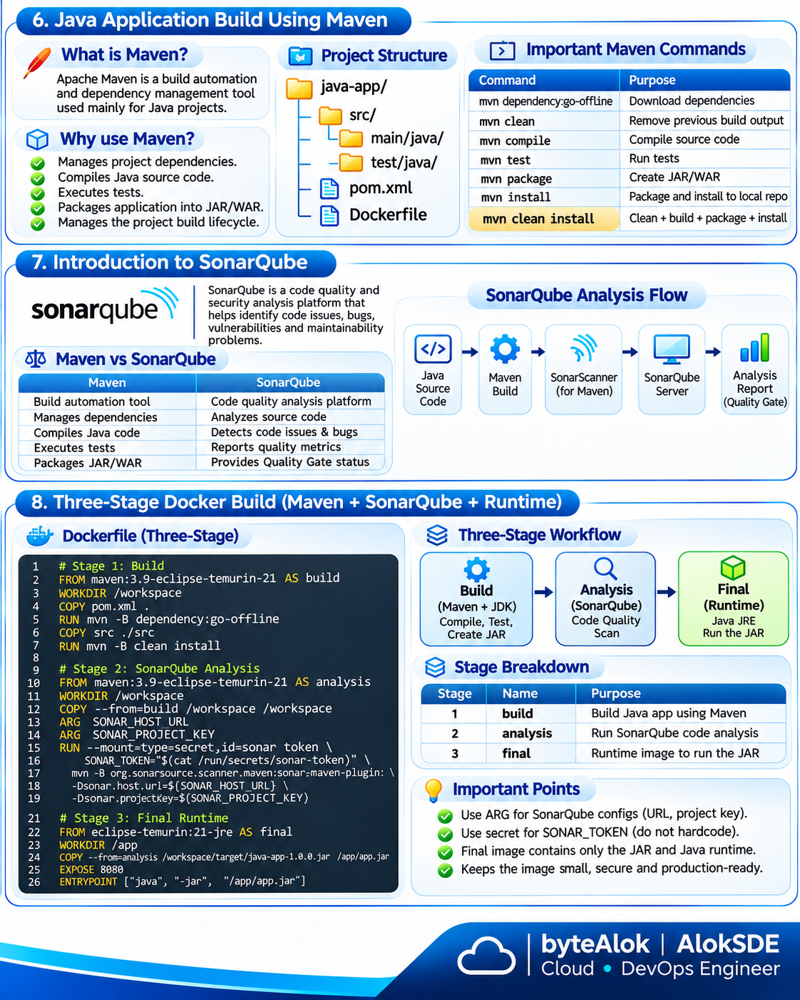

# 🐳 Day 06 – Multi-Stage Docker Build, Maven & SonarQube

> 🚀 Learning how to build Java applications using Maven, perform code quality analysis using SonarQube, implement Docker Multi-Stage Builds, and optimize Docker images.

<p align="center">
  
  
</p>

## 📚 Topics Covered

- 🏗️ Introduction to Multi-Stage Docker Build
- 🔄 Understanding Multiple Build Stages
- 📦 Build Stage vs Final Stage
- 📋 Using `COPY --from`
- 🔢 Copying Files Between Different Stages
- 🐍 Understanding Stage Names and Stage Numbers
- ☕ Java Application Build using Maven
- 🔍 Code Quality Analysis using SonarQube
- 🏗️ Three-Stage Docker Build – Maven + SonarQube + Runtime
- 🏗️ Two-Stage Docker Build – Maven + Runtime
- 🚀 Docker Image Optimization Process
- ⚖️ Single-Stage vs Multi-Stage Build
- 📊 Comparing Docker Image Sizes
- 💼 Interview Preparation – Top 10 Questions

---

## 1. 🏗️ Introduction to Multi-Stage Docker Build

**📖 Definition:**

Multi-Stage Docker Build is a Docker feature that allows us to use multiple `FROM` instructions in a single Dockerfile.

Each `FROM` instruction starts a new build stage.

We can use one stage to build or prepare the application and copy only the required files into another stage to create the final image.

**💡 Why use Multi-Stage Builds?**

During application development, we may need several tools, dependencies, and files to build the application.

However, these tools may not be required when running the final application.

Multi-stage builds help us keep the final Docker image smaller by excluding unnecessary build-time files and dependencies.

### 🔍 Understanding Multi-Stage Build

```text
          📄 Dockerfile
                |
                ▼
        ┌─────────────────┐
        │   Build Stage   │
        │                 │
        │ Build Tools     │
        │ Dependencies    │
        │ Source Code     │
        └────────┬────────┘
                 |
                 │ COPY --from
                 ▼
        ┌─────────────────┐
        │   Final Stage   │
        │                 │
        │ Required Files  │
        │ Runtime         │
        │ Application     │
        └────────┬────────┘
                 |
                 ▼
           📦 Final Image
```

**📌 Important:**

- Each `FROM` instruction starts a new stage.
- Every stage can use a different base image.
- We can name stages using `AS`.
- We can copy files from one stage to another using `COPY --from`.
- Only the final stage is used as the resulting image by default.
- The final stage does not automatically inherit the files or installed packages from previous stages.

---

## 2. 🔄 Understanding Multiple Build Stages

A Dockerfile can contain multiple `FROM` instructions.

### 📝 Syntax

```dockerfile
FROM image_name AS stage_name

# Instructions for first stage

FROM image_name AS another_stage

# Instructions for second stage
```

### 💻 Example

```dockerfile
FROM ubuntu AS build

WORKDIR /app

RUN echo "Build Stage"

FROM ubuntu AS final

WORKDIR /app

RUN echo "Final Stage"
```

**Explanation:**

**First Stage:**

```dockerfile
FROM ubuntu AS build
```

- `FROM ubuntu` → Selects Ubuntu as the base image.
- `AS build` → Assigns the stage name `build`.

**Second Stage:**

```dockerfile
FROM ubuntu AS final
```

- Starts another stage using Ubuntu.
- `AS final` → Assigns the stage name `final`.

**💡 Remember:**

Each `FROM` starts a new stage. The second stage does not automatically inherit the files or installed packages from the first stage.

To transfer files between stages, we use `COPY --from`.

---

## 3. 📋 COPY --from Instruction

### 📝 Syntax

```dockerfile
COPY --from=stage_name source destination
```

**📖 Definition:**

`COPY --from` copies files or directories from another build stage or an external image into the current stage.

**💡 Why use it?**

It allows us to transfer only the required application files from the build stage into the final stage.

### 💻 Example

```dockerfile
FROM ubuntu AS build

WORKDIR /app

RUN echo "Hello from Build Stage" > message.txt

FROM ubuntu AS final

WORKDIR /app

COPY --from=build /app/message.txt /app/message.txt
```

**Explanation:**

| Instruction | Description |
|---|---|
| `FROM ubuntu AS build` | Creates the first stage named `build` |
| `WORKDIR /app` | Sets the working directory |
| `RUN echo ...` | Creates a file in the build stage |
| `FROM ubuntu AS final` | Starts the final stage |
| `COPY --from=build` | Copies a file from the build stage |
| `/app/message.txt` | Source file in the build stage |
| `/app/message.txt` | Destination file in the final stage |

**📂 Understanding File Transfer:**

```text
       🏗️ BUILD STAGE
       /app/message.txt
               |
               |
               ▼
       COPY --from=build
               |
               ▼
       🚀 FINAL STAGE
       /app/message.txt
```

**📌 Important:**

The final stage receives the copied file, not the complete filesystem of the build stage.

---

## 4. 🔢 Copying Files Between Different Stages

Docker allows us to copy files from a previously defined stage by using its name or stage index.

### 🅰️ Method 1: Copy Using Stage Name

**Syntax:**

```dockerfile
COPY --from=build /source/path /destination/path
```

**Example:**

```dockerfile
FROM ubuntu AS build

WORKDIR /app

RUN echo "Hello Docker" > app.txt

FROM ubuntu AS final

WORKDIR /app

COPY --from=build /app/app.txt /app/app.txt
```

Here:

- `build` is the source stage.
- `/app/app.txt` is the source file.
- `/app/app.txt` is the destination in the current stage.

### 🅱️ Method 2: Copy Using Stage Number

Docker stage indexes start from `0`.

**Example:**

```dockerfile
FROM ubuntu

WORKDIR /app

RUN echo "First Stage" > first.txt


FROM ubuntu

WORKDIR /app

RUN echo "Second Stage" > second.txt


FROM ubuntu

WORKDIR /app

COPY --from=0 /app/first.txt /app/first.txt
COPY --from=1 /app/second.txt /app/second.txt
```

**Stage Index Explanation:**

| Stage | Index |
|---|---:|
| First `FROM ubuntu` | `0` |
| Second `FROM ubuntu` | `1` |
| Third `FROM ubuntu` | `2` |

**Important:**

- Stage indexes start from `0`, not `1`.
- `COPY --from=0` copies from the first stage.
- `COPY --from=1` copies from the second stage.
- Stage names are generally easier to understand and maintain than numeric indexes.

### 🅲 Method 3: Copy from One Stage to Another Stage

Suppose we have three stages:

```dockerfile
FROM ubuntu AS stage1

WORKDIR /app

RUN echo "File from Stage 1" > file1.txt


FROM ubuntu AS stage2

WORKDIR /app

COPY --from=stage1 /app/file1.txt /app/file1.txt

RUN echo "File from Stage 2" > file2.txt


FROM ubuntu AS stage3

WORKDIR /app

COPY --from=stage2 /app/file2.txt /app/file2.txt

COPY --from=stage1 /app/file1.txt /app/file1.txt
```

**Understanding:**

- `stage2` receives `file1.txt` from `stage1`.
- `stage3` receives `file2.txt` from `stage2`.
- `stage3` also directly receives `file1.txt` from `stage1`.

**💡 Important:** A later stage can copy from any previously defined stage. It does not have to copy only from the immediately preceding stage.

---

## 5. ☕ Java Application Build using Maven

Now let's use a Java application to understand how Maven and SonarQube work with Docker Multi-Stage Builds.

### 🔍 What is Maven?

**Definition:**

Apache Maven is a build automation and dependency management tool used mainly for Java projects.

**Why use Maven?**

- 📦 Manages project dependencies.
- ⚙️ Compiles Java source code.
- 🧪 Executes tests.
- 🏗️ Packages applications into JAR or WAR files.
- 🔄 Manages the project build lifecycle.

### 📂 Project Structure

```text
java-app/
│
├── src/
│   ├── main/
│   │   └── java/
│   │       └── com/example/
│   │           └── Application.java
│   │
│   └── test/
│       └── java/
│           └── com/example/
│               └── ApplicationTest.java
│
├── pom.xml
└── Dockerfile
```

**File Description:**

| File / Directory | Purpose |
|---|---|
| `src/main/java` | Contains application source code |
| `src/test/java` | Contains test classes |
| `pom.xml` | Maven project configuration |
| `Dockerfile` | Contains Docker image build instructions |

### 📝 Application.java

```java
package com.example;

public class Application {

    public static void main(String[] args) {

        System.out.println("Java Application Running!");

    }
}
```

### 📝 pom.xml

```xml
<project xmlns="http://maven.apache.org/POM/4.0.0"
         xmlns:xsi="http://www.w3.org/2001/XMLSchema-instance"
         xsi:schemaLocation="http://maven.apache.org/POM/4.0.0
         https://maven.apache.org/xsd/maven-4.0.0.xsd">

    <modelVersion>4.0.0</modelVersion>

    <groupId>com.example</groupId>
    <artifactId>java-app</artifactId>
    <version>1.0.0</version>

    <properties>
        <maven.compiler.release>21</maven.compiler.release>
        <project.build.sourceEncoding>UTF-8</project.build.sourceEncoding>
    </properties>

    <build>
        <plugins>

            <plugin>
                <groupId>org.apache.maven.plugins</groupId>
                <artifactId>maven-compiler-plugin</artifactId>
                <version>3.13.0</version>
            </plugin>

            <plugin>
                <groupId>org.sonarsource.scanner.maven</groupId>
                <artifactId>sonar-maven-plugin</artifactId>
                <version>5.5.0.6356</version>
            </plugin>

        </plugins>
    </build>

</project>
```

### 🔍 Understanding Important Maven Terms

| Term | Description |
|---|---|
| `groupId` | Identifies the project or organization |
| `artifactId` | Project or artifact name |
| `version` | Project version |
| `maven.compiler.release` | Java release level used for compilation |
| `maven-compiler-plugin` | Compiles Java source code |
| `sonar-maven-plugin` | Executes SonarQube analysis through Maven |

**📌 Important:**

The example uses Java 21. The JDK used for compilation and the runtime Java version should be compatible.

### ⚙️ Important Maven Commands

**1. Download Dependencies**

```bash
mvn dependency:go-offline
```

Downloads project dependencies and required plugins in advance where possible.

**2. Clean Project**

```bash
mvn clean
```

Removes the previous build output, usually the `target` directory.

**3. Compile Project**

```bash
mvn compile
```

Compiles application source code.

**4. Run Tests**

```bash
mvn test
```

Executes the project's tests.

**5. Package Application**

```bash
mvn package
```

Packages the application into a JAR or WAR, depending on the project configuration.

**6. Install Application**

```bash
mvn install
```

Executes the Maven lifecycle through the install phase and places the generated artifact in the local Maven repository.

**7. Clean + Install in One Command**

```bash
mvn clean install
```

<badge color="success">Important Maven Command</badge>

This is the command we will use in our Docker build stage.

**Breakdown:**

| Part | Meaning |
|---|---|
| `mvn` | Executes Maven |
| `clean` | Removes the previous build output |
| `install` | Executes the build lifecycle through the install phase and stores the generated artifact in the local Maven repository |

**What happens during `mvn clean install`?**

1. Removes previous build output.
2. Validates the project.
3. Processes resources.
4. Compiles Java source code.
5. Compiles test source code.
6. Executes tests.
7. Packages the application into JAR/WAR.
8. Runs verification steps.
9. Installs the generated artifact into the local Maven repository.

**📦 Expected JAR Location:**

```text
target/java-app-1.0.0.jar
```

The actual filename depends on the Maven `artifactId` and `version`.

**💡 Remember:**

`mvn clean install` already executes the earlier required lifecycle phases. We do not need to separately execute `mvn compile`, `mvn test`, and `mvn package` before it.

---

## 6. 🔍 Introduction to SonarQube

**📖 Definition:**

SonarQube is a code quality and security analysis platform that helps developers identify code issues, bugs, vulnerabilities, and maintainability problems.

**💡 Why use SonarQube?**

- 🔍 Detect code quality issues.
- 🐛 Identify potential bugs.
- 🔐 Detect security-related issues.
- 📊 Analyze code maintainability.
- 🚦 Evaluate Quality Gate status.

### ⚖️ Maven vs SonarQube

| Maven | SonarQube |
|---|---|
| Build automation tool | Code quality analysis platform |
| Manages dependencies | Analyzes source code |
| Compiles Java code | Detects code issues |
| Executes tests | Reports analysis results |
| Packages JAR/WAR | Provides quality metrics and Quality Gate |

**Important:**

SonarQube Server is a separate service. We do not need to install the SonarQube Server inside every application image.

We connect our application build or analysis process to an already running SonarQube Server.

### 🔗 SonarQube Analysis Flow

```text
       ☕ Java Source Code
                |
                ▼
          ⚙️ Maven Build
                |
                ▼
       🔍 SonarScanner for Maven
                |
                ▼
       ☁️ SonarQube Server
                |
                ▼
          📊 Analysis Report
                |
                ▼
           🚦 Quality Gate
```

### 📌 Important SonarQube Terms

| Term | Description |
|---|---|
| SonarQube Server | Receives and processes code analysis |
| SonarScanner | Sends project analysis to SonarQube |
| Project Key | Unique identifier of a project |
| Token | Authentication credential |
| Quality Gate | Checks whether configured quality conditions pass |

---

## 7. 🏗️ Three-Stage Docker Build – Maven + SonarQube + Runtime

Now we will create a three-stage Dockerfile using Maven, SonarQube, and a Java runtime image.

### 🎯 Our Three Stages

| Stage | Name | Purpose |
|---|---|---|
| Stage 1 | `build` | Compile, test and package Java application using Maven |
| Stage 2 | `analysis` | Perform SonarQube code analysis |
| Stage 3 | `final` | Run the generated JAR using Java Runtime |

### 🔍 Architecture

```text
             📄 Dockerfile
                    |
                    ▼
          ┌───────────────────┐
          │  STAGE 1: BUILD   │
          │                   │
          │ Maven + JDK       │
          │                   │
          │ Dependencies      │
          │ Compile + Test    │
          │ Package JAR       │
          └─────────┬─────────┘
                    |
                    │ COPY --from=build
                    ▼
          ┌───────────────────┐
          │ STAGE 2: ANALYSIS │
          │                   │
          │ Maven + JDK       │
          │                   │
          │ Source Code       │
          │ Compiled Output   │
          │ SonarQube Scan    │
          └─────────┬─────────┘
                    |
                    │ COPY --from=analysis
                    ▼
          ┌───────────────────┐
          │ STAGE 3: FINAL    │
          │                   │
          │ Java JRE          │
          │                   │
          │ Executable JAR    │
          │ Application       │
          └─────────┬─────────┘
                    |
                    ▼
              🚀 Container
```

### 💻 Complete Three-Stage Dockerfile

```dockerfile
# syntax=docker/dockerfile:1

# ==================================
# STAGE 1: BUILD
# ==================================

FROM maven:3.9-eclipse-temurin-21 AS build

WORKDIR /workspace

# Copy Maven configuration first
COPY pom.xml .

# Download project dependencies
RUN mvn -B dependency:go-offline

# Copy application source code
COPY src ./src

# Clean and install Java application
RUN mvn -B clean install


# ==================================
# STAGE 2: SONARQUBE ANALYSIS
# ==================================

FROM maven:3.9-eclipse-temurin-21 AS analysis

WORKDIR /workspace

# Copy build output and source from build stage
COPY --from=build /workspace /workspace

# SonarQube configuration
ARG SONAR_HOST_URL
ARG SONAR_PROJECT_KEY

# Run SonarQube analysis
RUN --mount=type=secret,id=sonar_token \
    SONAR_TOKEN="$(cat /run/secrets/sonar_token)" \
    mvn -B org.sonarsource.scanner.maven:sonar-maven-plugin:5.5.0.6356:sonar \
    -Dsonar.host.url="${SONAR_HOST_URL}" \
    -Dsonar.projectKey="${SONAR_PROJECT_KEY}"


# ==================================
# STAGE 3: FINAL RUNTIME
# ==================================

FROM eclipse-temurin:21-jre AS final

WORKDIR /app

# Copy only the executable JAR
COPY --from=analysis /workspace/target/java-app-1.0.0.jar /app/app.jar

EXPOSE 8080

ENTRYPOINT ["java", "-jar", "/app/app.jar"]
```

### 🔍 Stage 1: Build Stage

```dockerfile
FROM maven:3.9-eclipse-temurin-21 AS build
```

**Explanation:**

- `FROM` → Selects a base image and starts a new stage.
- `maven:3.9-eclipse-temurin-21` → Provides Maven and Java 21 JDK.
- `AS build` → Assigns the stage name `build`.

```dockerfile
WORKDIR /workspace
```

Sets `/workspace` as the working directory.

```dockerfile
COPY pom.xml .
```

Copies Maven configuration into the working directory.

```dockerfile
RUN mvn -B dependency:go-offline
```

Downloads project dependencies and required plugins in advance where possible.

```dockerfile
COPY src ./src
```

Copies Java source code and tests into the working directory.

```dockerfile
RUN mvn -B clean install
```

Executes the Maven build lifecycle through the install phase.

It cleans previous output, compiles the application, executes tests, packages the JAR, and installs the generated artifact into the local Maven repository.

**📦 Result:**

The JAR file is generated inside:

```text
/workspace/target/java-app-1.0.0.jar
```

### 🔍 Stage 2: Analysis Stage

```dockerfile
FROM maven:3.9-eclipse-temurin-21 AS analysis
```

Starts another stage using Maven and Java 21.

```dockerfile
WORKDIR /workspace
```

Sets the working directory.

```dockerfile
COPY --from=build /workspace /workspace
```

Copies the entire workspace from the `build` stage into the `analysis` stage.

This includes:

- `pom.xml`
- `src/`
- `target/`
- Compiled classes
- Generated JAR

```dockerfile
ARG SONAR_HOST_URL
ARG SONAR_PROJECT_KEY
```

Defines build-time variables.

| Variable | Purpose |
|---|---|
| `SONAR_HOST_URL` | SonarQube Server URL |
| `SONAR_PROJECT_KEY` | Unique project identifier in SonarQube |

```dockerfile
RUN --mount=type=secret,id=sonar_token \
    SONAR_TOKEN="$(cat /run/secrets/sonar_token)" \
    mvn -B org.sonarsource.scanner.maven:sonar-maven-plugin:5.5.0.6356:sonar \
    -Dsonar.host.url="${SONAR_HOST_URL}" \
    -Dsonar.projectKey="${SONAR_PROJECT_KEY}"
```

**Command Breakdown:**

| Part | Description |
|---|---|
| `RUN` | Executes the command during image build |
| `--mount=type=secret` | Temporarily makes a secret available to the build |
| `id=sonar_token` | Identifies the secret |
| `/run/secrets/sonar_token` | Secret file path inside the build command |
| `SONAR_TOKEN` | Authentication token environment variable |
| `mvn -B` | Executes Maven in batch mode |
| `sonar-maven-plugin` | Maven plugin used for SonarQube analysis |
| `sonar` | Executes the SonarQube analysis goal |
| `sonar.host.url` | SonarQube Server URL |
| `sonar.projectKey` | Project identifier |

**📌 Important:**

- SonarQube Server must already be running and reachable.
- The token must have the required analysis permissions.
- The token should not be hardcoded into the Dockerfile.
- The analysis stage requires the source code and compiled output.
- Analysis results are submitted to the SonarQube Server.
- A successful scanner execution does not automatically mean the Quality Gate has passed.

### 🔍 Stage 3: Final Runtime Stage

```dockerfile
FROM eclipse-temurin:21-jre AS final
```

**Explanation:**

- Starts the final stage.
- Uses Java 21 JRE.
- Maven and JDK build tools are not required in this runtime stage.

```dockerfile
WORKDIR /app
```

Sets `/app` as the working directory.

```dockerfile
COPY --from=analysis /workspace/target/java-app-1.0.0.jar /app/app.jar
```

Copies only the generated JAR from the analysis stage.

```dockerfile
EXPOSE 8080
```

Documents the container port expected by the application.

```dockerfile
ENTRYPOINT ["java", "-jar", "/app/app.jar"]
```

Defines the command that executes when the container starts.

### 📌 Complete Stage Summary

| Stage | Base Image | Included Content |
|---|---|---|
| `build` | Maven + JDK | Source code, dependencies, compiled output, JAR |
| `analysis` | Maven + JDK | Source code, compiled output, JAR, Sonar analysis |
| `final` | Java JRE | Required executable JAR |

**💡 Important:**

The final image does not contain the Maven build environment or SonarQube scanner stage. Only the required JAR is copied into the runtime image.

---

## 8. 🔐 SonarQube Configuration and Docker Build

The SonarQube analysis stage requires a running SonarQube Server.

### 📌 Required Information

| Value | Example |
|---|---|
| SonarQube Server URL | `http://YOUR_SONARQUBE_HOST:9000` |
| Project Key | `java-app` |
| Token | Your SonarQube analysis token |

### 📌 Step 1: Create SonarQube Token

1. Open your SonarQube Server.
2. Log in.
3. Open account settings.
4. Navigate to security/token settings.
5. Generate a token with the required project analysis permissions.
6. Keep the token private.

### 📌 Step 2: Create Secret File

Linux/macOS shell example:

```bash
printf '%s' 'YOUR_SONAR_TOKEN' > sonar_token.txt
```

This creates a local file containing the token.

**⚠️ Important:**

Do not commit this file to GitHub.

Add it to `.gitignore`:

```text
sonar_token.txt
```

### 📌 Step 3: Build Docker Image

```bash
DOCKER_BUILDKIT=1 docker build \
  --secret id=sonar_token,src=sonar_token.txt \
  --build-arg SONAR_HOST_URL=http://YOUR_SONARQUBE_HOST:9000 \
  --build-arg SONAR_PROJECT_KEY=java-app \
  -t java-app .
```

### 🔍 Command Breakdown

| Part | Description |
|---|---|
| `DOCKER_BUILDKIT=1` | Enables BuildKit for the build command |
| `docker build` | Builds the Docker image |
| `--secret` | Supplies a build-time secret |
| `id=sonar_token` | Secret identifier |
| `src=sonar_token.txt` | Local secret file |
| `--build-arg` | Passes a build-time argument |
| `SONAR_HOST_URL` | SonarQube Server URL |
| `SONAR_PROJECT_KEY` | SonarQube project key |
| `-t java-app` | Names the image |
| `.` | Current directory as build context |

### 📌 Step 4: Run Container

```bash
docker run -d \
  --name java-container \
  -p 8080:8080 \
  java-app
```

### 📌 Step 5: Verify Container

```bash
docker ps
```

### 📌 Step 6: Check Logs

```bash
docker logs java-container
```

**💡 Important:**

This is a learning example of running SonarQube analysis during a Docker build. SonarQube analysis is commonly performed as a separate CI/CD pipeline step in production workflows.

Also, Docker build arguments are not suitable for secrets. Use BuildKit secret mounts for tokens.

---

## 9. 🏗️ Two-Stage Docker Build – Maven + Runtime

Sometimes we do not need SonarQube analysis inside the Docker build.

In that case, we can create a simpler two-stage Dockerfile.

### 🎯 Our Two Stages

| Stage | Name | Purpose |
|---|---|---|
| Stage 1 | `build` | Compile, test and package Java application |
| Stage 2 | `final` | Run the generated JAR |

### 💻 Complete Two-Stage Dockerfile

```dockerfile
# ==================================
# STAGE 1: BUILD
# ==================================

FROM maven:3.9-eclipse-temurin-21 AS build

WORKDIR /workspace

COPY pom.xml .

RUN mvn -B dependency:go-offline

COPY src ./src

RUN mvn -B clean install


# ==================================
# STAGE 2: FINAL
# ==================================

FROM eclipse-temurin:21-jre AS final

WORKDIR /app

COPY --from=build /workspace/target/java-app-1.0.0.jar /app/app.jar

EXPOSE 8080

ENTRYPOINT ["java", "-jar", "/app/app.jar"]
```

### 🔍 How It Works

```text
        🏗️ STAGE 1: BUILD
        Maven + JDK
              |
              ▼
        Source Code
              |
              ▼
        Dependencies
              |
              ▼
        Clean + Install
              |
              ▼
        Generate JAR
              |
              │ COPY --from=build
              ▼
        🚀 STAGE 2: FINAL
        Java JRE
              |
              ▼
        Copy Executable JAR
              |
              ▼
        Run Application
```

### 📋 Important COPY Instruction

```dockerfile
COPY --from=build /workspace/target/java-app-1.0.0.jar /app/app.jar
```

**Explanation:**

- `--from=build` → Selects the build stage.
- `/workspace/target/java-app-1.0.0.jar` → Source JAR path.
- `/app/app.jar` → Destination path in the final stage.

**💡 Remember:**

This is the main purpose of Multi-Stage Builds: build the application in one environment and run it in another environment containing only the required runtime files.

### 🚀 Build and Run

**Build Image:**

```bash
docker build -t java-app .
```

**Run Container:**

```bash
docker run -d \
  --name java-container \
  -p 8080:8080 \
  java-app
```

**Check Container:**

```bash
docker ps
```

**Check Logs:**

```bash
docker logs java-container
```

---

## 10. 🚀 Docker Image Optimization Process

**📖 Definition:**

Docker Image Optimization is the process of reducing unnecessary image size and improving image build efficiency.

Multi-stage builds are one of the techniques used for image optimization.

### 🔴 Single-Stage Build

In a single-stage build, build and runtime requirements generally exist in the same image.

```dockerfile
FROM maven:3.9-eclipse-temurin-21

WORKDIR /workspace

COPY pom.xml .

RUN mvn -B dependency:go-offline

COPY src ./src

RUN mvn -B clean install

EXPOSE 8080

ENTRYPOINT ["java", "-jar", "target/java-app-1.0.0.jar"]
```

**Possible Limitation:**

The Maven image includes Maven and a JDK. These tools may remain in the final image even though they are not required to run the application.

### 🟢 Multi-Stage Build

```dockerfile
# Build Stage
FROM maven:3.9-eclipse-temurin-21 AS build

WORKDIR /workspace

COPY pom.xml .

RUN mvn -B dependency:go-offline

COPY src ./src

RUN mvn -B clean install


# Final Stage
FROM eclipse-temurin:21-jre AS final

WORKDIR /app

COPY --from=build /workspace/target/java-app-1.0.0.jar /app/app.jar

ENTRYPOINT ["java", "-jar", "/app/app.jar"]
```

**Advantages:**

- Build and runtime environments can be separated.
- Unnecessary build-time files can be excluded from the final image.
- A smaller runtime base image can be selected.
- Only required files need to be copied into the final stage.

### ⚖️ Single-Stage vs Multi-Stage Build

| Single-Stage Build | Multi-Stage Build |
|---|---|
| Uses one build stage | Uses multiple build stages |
| Build and runtime requirements may exist together | Build and runtime environments can be separated |
| Build tools may remain in final image | Build tools can be excluded |
| Can produce larger images | Can produce smaller images |
| Simpler Dockerfile | Requires stage planning |

### 📌 Additional Image Optimization Techniques

**1. Use a Suitable Base Image**

```dockerfile
FROM eclipse-temurin:21-jre
```

Use a runtime image instead of a full Maven/JDK image when only application execution is required.

**2. Use Docker Build Cache**

```dockerfile
COPY pom.xml .

RUN mvn -B dependency:go-offline

COPY src ./src
```

Copying the dependency configuration separately helps Docker reuse cached dependency layers when only source files change.

**3. Avoid Unnecessary Files**

A `.dockerignore` file can exclude files and directories from the build context.

**Example `.dockerignore`:**

```text
.git
target/
.idea/
*.log
.env
```

**4. Copy Only Required Artifacts**

```dockerfile
COPY --from=build /workspace/target/java-app-1.0.0.jar /app/app.jar
```

Copies only the required JAR instead of the complete build environment.

**5. Avoid Unnecessary Dependencies**

Only include dependencies and packages that are required by the application.

**💡 Important:**

Multi-stage builds do not automatically guarantee a smaller image. The final image size depends on the base image, copied files, installed dependencies, and contents of the final stage.

---

## 11. 📊 Verify and Compare Docker Image Sizes

We can use Docker commands to inspect locally available images.

### 📋 List Images

```bash
docker images
```

**Example Output:**

```text
REPOSITORY       TAG       IMAGE ID       SIZE
java-single      latest    abc123         ...
java-multistage  latest    def456         ...
```

### 🔍 Inspect Image Details

```bash
docker image inspect java-multistage
```

**Definition:** Displays detailed information about a Docker image in JSON format.

### 📌 Compare Image Sizes

Build both single-stage and multi-stage images and compare their sizes.

```bash
docker images
```

Check the `SIZE` column.

**Important:** The multi-stage image will not always be smaller. The actual result depends on the application and the files and dependencies included in each image.

---

## 12. 💼 Top 10 Docker, Maven & SonarQube Interview Questions

### Q1. What is Multi-Stage Docker Build, and why do we use it?

**Answer:**

Multi-Stage Docker Build allows us to use multiple `FROM` instructions in a single Dockerfile.

Each `FROM` starts a separate stage.

We use it to separate build-time requirements from runtime requirements.

For example, a Java application needs Maven and JDK for compilation, but it may only need Java Runtime to execute the generated JAR.

We can copy the JAR into a smaller final image using `COPY --from` and exclude unnecessary build tools.

### Q2. What is the difference between `COPY` and `COPY --from`?

**Answer:**

`COPY` copies files from the Docker build context into the current image stage.

Example:

```dockerfile
COPY src ./src
```

`COPY --from` copies files from another build stage or an external image into the current stage.

Example:

```dockerfile
COPY --from=build /app/app.jar /app/app.jar
```

The main difference is the source of the files.

### Q3. Can we copy files directly from the first stage to the third stage?

**Answer:**

Yes.

We can copy files from any previously defined stage using its name or stage index.

Example:

```dockerfile
FROM ubuntu AS stage1

RUN echo "Hello" > /message.txt


FROM ubuntu AS stage2

RUN echo "Second Stage"


FROM ubuntu AS stage3

COPY --from=stage1 /message.txt /message.txt
```

The third stage directly copies the file from the first stage. It does not need to pass through the second stage.

### Q4. What is Maven, and what is the purpose of `pom.xml`?

**Answer:**

Apache Maven is a Java build automation and dependency management tool.

It helps developers:

- Manage dependencies.
- Compile source code.
- Execute tests.
- Package applications.
- Manage the build lifecycle.

`pom.xml` stands for Project Object Model. It contains project information, dependencies, plugins, versions, and build configuration.

### Q5. What is the difference between `mvn package`, `mvn install`, and `mvn clean install`?

**Answer:**

| Command | Purpose |
|---|---|
| `mvn package` | Packages the application into a JAR or WAR |
| `mvn install` | Executes the lifecycle through install and places the artifact in the local Maven repository |
| `mvn clean install` | Removes previous build output, executes the lifecycle through install, and stores the generated artifact in the local Maven repository |

`mvn clean install` is useful when we want a clean build and installation in one command.

It executes the required earlier lifecycle phases, including compilation, tests, and packaging.

### Q6. What is SonarQube, and why do we use it?

**Answer:**

SonarQube is a code quality and security analysis platform.

It helps identify:

- Bugs.
- Vulnerabilities.
- Code smells.
- Maintainability issues.
- Other configured code quality problems.

It helps development teams maintain better code quality.

### Q7. What is the difference between SonarScanner and SonarQube Server?

**Answer:**

SonarScanner performs the project analysis and sends the results to SonarQube Server.

SonarQube Server receives and processes the analysis results and displays reports, metrics, and Quality Gate status.

For Maven projects, we can execute SonarScanner through the SonarScanner for Maven plugin.

### Q8. What is a Quality Gate in SonarQube?

**Answer:**

A Quality Gate is a collection of conditions configured in SonarQube.

It evaluates the analysis results and determines whether the project meets the configured quality requirements.

A successful scanner execution does not automatically mean that the Quality Gate has passed.

### Q9. How does Multi-Stage Docker Build help in Image Optimization?

**Answer:**

Multi-stage builds separate the build environment from the runtime environment.

For example:

- Maven and JDK are used in the build stage.
- Java JRE is used in the final stage.
- Only the generated JAR is copied into the final image.

This prevents unnecessary build tools and files from being included in the final image.

Other optimization techniques include selecting suitable base images, using build cache, avoiding unnecessary dependencies, and using `.dockerignore`.

### Q10. How would you troubleshoot a Java application that exits immediately inside a Docker container?

**Answer:**

I would follow these steps:

**Step 1: Check all containers**

```bash
docker ps -a
```

This identifies whether the container is running or has exited.

**Step 2: Check container logs**

```bash
docker logs <container_id>
```

This helps identify application errors.

**Step 3: Inspect container configuration**

```bash
docker inspect <container_id>
```

This displays container configuration and runtime details.

**Step 4: Verify the JAR file**

Check whether the JAR was generated successfully and whether the `COPY --from` source path is correct.

**Step 5: Verify Java compatibility**

Check whether the Java version used during compilation is compatible with the runtime version in the final image.

**Step 6: Verify application configuration**

Check the startup command, required environment variables, dependencies, and port configuration.

---

## 📌 Quick Command Reference

| Command | Purpose |
|---|---|
| `mvn dependency:go-offline` | Download dependencies in advance |
| `mvn clean install` | Clean, build, test, package and install the artifact |
| `mvn verify` | Execute the Maven lifecycle up to verification |
| `docker build -t java-app .` | Build Docker image |
| `docker images` | List local Docker images |
| `docker image inspect java-app` | Inspect image details |
| `docker ps -a` | List all containers |
| `docker logs <container_id>` | View container logs |
| `docker inspect <container_id>` | Inspect container details |
| `docker exec -it <container_id> /bin/sh` | Open a shell inside a running container |

---

## 🎯 Learning Outcomes

After completing Day 06, I understood:

- 🏗️ What Multi-Stage Docker Builds are.
- 🔄 How multiple `FROM` instructions work.
- 📦 Difference between build stage and final stage.
- 📋 How to transfer files between stages using `COPY --from`.
- 🔢 How to copy files using stage names and stage indexes.
- 🔀 How to copy files directly between non-adjacent stages.
- ☕ How Maven builds Java applications.
- 📄 How `pom.xml` manages project dependencies and build configuration.
- ⚙️ How `mvn clean install` executes the Maven build lifecycle.
- 🔍 How SonarQube performs code quality analysis.
- 🏗️ How to create a three-stage Dockerfile using Maven, SonarQube, and Java Runtime.
- 🏗️ How to create a two-stage Dockerfile using Maven and Java Runtime.
- 🚀 How Multi-Stage Builds help with image optimization.
- 📊 How to inspect and compare Docker image sizes.
- 💼 Important interview questions related to Docker, Maven, SonarQube, Image Optimization, and Troubleshooting.

---

## 🤝 Let's Connect

👨‍💻 **GitHub:** [@byteAlok](https://github.com/byteAlok)

🌐 **Portfolio:** [aloksde.com](https://aloksde.com)

⭐ If you find these notes helpful, consider giving this repository a Star. It motivates me to keep learning, documenting, and sharing practical knowledge.

**Thanks for visiting! Happy Learning & Keep Building! 🚀**
