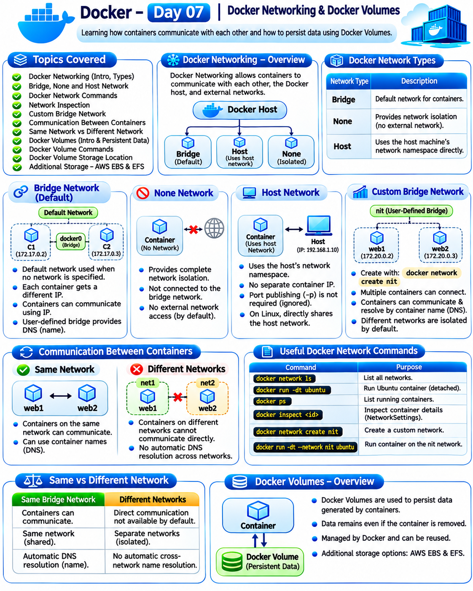
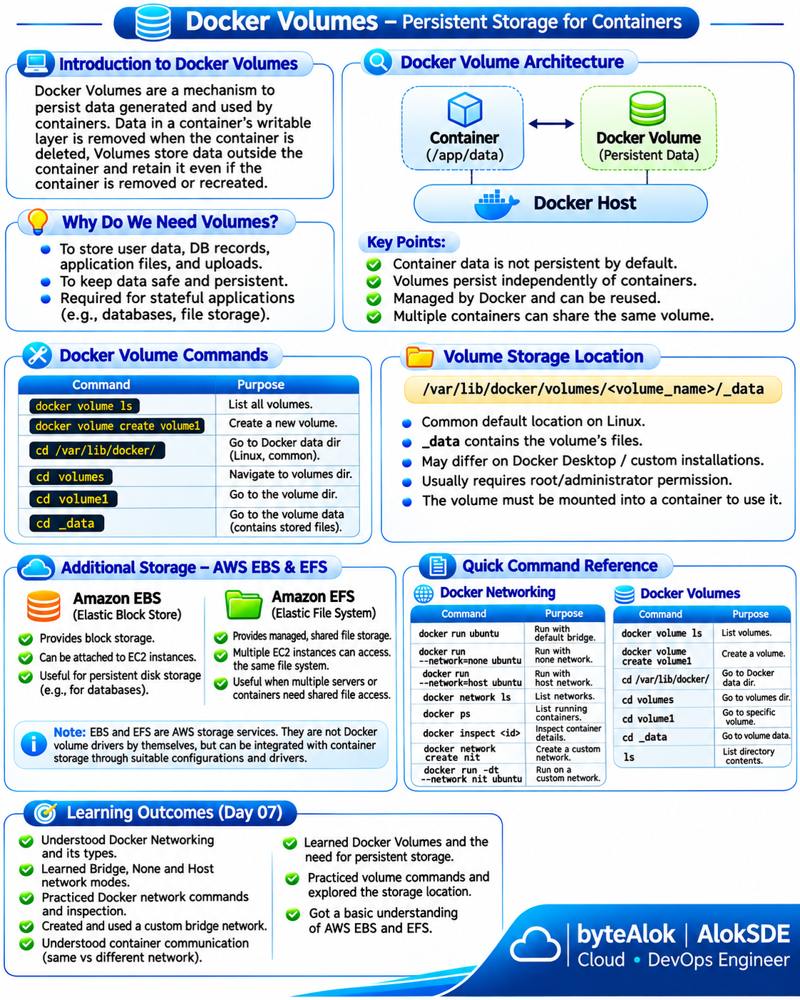

# 🐳 Day 07 – Docker Networking & Docker Volumes

> 🚀 Learning how Docker containers communicate with each other and how to persist container data using Docker Volumes.

<p align="center">
  
  
</p>

## 📚 Topics Covered

- 🌐 Introduction to Docker Networking
- 🔗 Bridge Network (Default)
- 🚫 None Network
- 🖥️ Host Network
- 📋 Docker Network Commands
- 🔍 Container Network Inspection
- 🌉 Custom Bridge Network
- 🔄 Communication Between Containers
- ⚖️ Same Network vs Different Network
- 💾 Introduction to Docker Volumes
- 📦 Persistent Storage
- 🛠️ Docker Volume Commands
- 📂 Docker Volume Storage Location
- ☁️ Additional Storage – AWS EBS & EFS

---

# 🌐 Part 1 – Docker Networking

## 1. 🌐 Introduction to Docker Networking

**📖 Defnition:**

Docker Networking allows containers to communicate with each other, the Docker host, and external networks.

When we create a container, Docker connects it to a network according to the selected network mode.

Docker provides different network drivers, including:

- Bridge
- Host
- None

### 🔍 Docker Network Types

<AsyncImage query="Docker bridge host none network drivers architecture diagram" aspectRatio="16:9" width="100%"/>

| Network Type | Description |
|---|---|
| Bridge | Default network for containers |
| None | Provides network isolation |
| Host | Uses the host machine's network namespace |

---

## 2. 🔗 Bridge Network (Default)

<badge color="success">Default Network</badge>

**📖 Defnition:**

Bridge is the default network driver used by Docker for containers when no other network is specified.

When we create a container without specifying a network, Docker connects it to the default bridge network.

### 💻 Example

```bash
docker run ubuntu
```

**Explanation:**

- `docker run` → Creates and starts a container.
- `ubuntu` → Specifies the Ubuntu image.
- No network option is provided, so Docker uses the default bridge network.

### 🔍 Bridge Network Architecture

<AsyncImage query="Docker default bridge network multiple containers Docker host gateway diagram" aspectRatio="16:9" width="100%"/>

**Understanding the Diagram:**

- Multiple containers connect to the same default bridge network.
- Each container receives its own IP address.
- Containers connected to the same bridge network can communicate through that network.
- They generally share the same network gateway.

### 📌 Important Points

- Bridge is the default network.
- Containers connected to the default bridge receive different IP addresses.
- They use the bridge network's gateway.
- Containers on the default bridge can communicate using IP addresses.
- User-defined bridge networks additionally provide automatic DNS-based container name resolution.

---

## 3. 🚫 None Network

**📖 Defnition:**

The None network driver provides network isolation to a container.

A container created with `none` does not get connected to the normal Docker bridge network.

### 💻 Command

```bash
docker run --network=none ubuntu
```

### 🔍 Command Breakdown

| Part | Meaning |
|---|---|
| `docker run` | Creates and starts a container |
| `--network=none` | Selects the None network |
| `ubuntu` | Uses the Ubuntu image |

### 🔍 Architecture

<AsyncImage query="Docker none network driver isolated container network diagram" aspectRatio="16:9" width="100%"/>

### 📌 Important Points

- Container is isolated from normal Docker networking.
- It does not connect to the default bridge network.
- Normal external network connectivity is unavailable.
- Other methods or network configuration can be used if communication is required.

---

## 4. 🖥️ Host Network

**📖 Defnition:**

Host networking allows a container to use the host machine's network namespace directly.

In this mode, the container does not get a separate network namespace with its own container IP address.

### 💻 Command

```bash
docker run --network=host ubuntu
```

### 🔍 Command Breakdown

| Part | Meaning |
|---|---|
| `docker run` | Creates and starts a container |
| `--network=host` | Selects Host networking |
| `ubuntu` | Uses the Ubuntu image |

### 🔍 Architecture

<AsyncImage query="Docker host network mode container shares host network namespace architecture diagram" aspectRatio="16:9" width="100%"/>

### 📌 Important Points

- Container uses the host network namespace.
- Container shares the host's network interfaces and IP addresses.
- Separate container network IP is not assigned in this mode.
- Port publishing with `-p` is unnecessary and ignored for host networking.
- On Linux, the container directly shares the host network namespace.

**💡 Example:**

If an application inside a host-networked container listens on port `5000`, it uses the host's port `5000` directly.

There is no separate Docker port mapping such as `-p 5000:5000`.

---

## 5. 📋 Docker Network Commands

Now let's understand the commands used to list and inspect Docker networks.

### 1. List Docker Networks

```bash
docker network ls
```

**Defnition:** Displays all Docker networks available on the host.

**Example Output:**

```text
NETWORK ID     NAME      DRIVER    SCOPE
abc123         bridge    bridge    local
def456         host      host      local
ghi789         none      null      local
```

**Explanation:**

| Network | Purpose |
|---|---|
| `bridge` | Default bridge network |
| `host` | Host networking |
| `none` | Network isolation |

### 2. Create a Detached Ubuntu Container

```bash
docker run -dt ubuntu
```

**Explanation:**

- `-d` → Runs the container in detached mode.
- `-t` → Allocates a pseudo-terminal.
- `ubuntu` → Uses the Ubuntu image.

This command creates and starts an Ubuntu container in the background.

### 3. List Containers

```bash
docker ps
```

**Defnition:** Displays currently running containers.

### 4. Inspect Container Network Details

```bash
docker inspect <container_id>
```

**Example:**

```bash
docker inspect abc123
```

You can also use the container name:

```bash
docker inspect container_name
```

**Defnition:** Displays detailed information about a container in JSON format.

For networking, inspect the `NetworkSettings` section.

It provides information such as:

- Container IP address.
- Network gateway.
- Connected network.
- Network configuration.

**💡 Why use it?**

To identify the container's IP address and understand which Docker network it is connected to.

---

## 6. 🌉 Custom Bridge Network

Docker also allows us to create our own bridge networks instead of using only the default bridge network.

**📖 Defnition:**

A Custom Bridge Network is a user-defined bridge network that allows containers to communicate with each other.

### 💻 Step 1: Create a Custom Network

```bash
docker network create nit
```

**Explanation:**

| Part | Meaning |
|---|---|
| `docker network` | Docker network management command |
| `create` | Creates a new network |
| `nit` | Name of the custom network |

Here, `nit` is a custom name selected by us. We can use another valid network name as well.

### 💻 Step 2: Run Container Using Custom Network

```bash
docker run -dt --network nit ubuntu
```

**Explanation:**

| Part | Meaning |
|---|---|
| `docker run` | Creates and starts a container |
| `-dt` | Detached mode with pseudo-terminal |
| `--network nit` | Connects container to the `nit` network |
| `ubuntu` | Uses the Ubuntu image |

### 🔍 Architecture

<AsyncImage query="Docker custom user defined bridge network multiple containers architecture diagram" aspectRatio="16:9" width="100%"/>

### 📌 Important Points

- We can create multiple custom bridge networks.
- Multiple containers can connect to the same custom bridge network.
- Containers on the same user-defined bridge network can communicate with each other.
- Docker provides automatic DNS resolution between containers on a user-defined bridge network.
- Containers on different bridge networks cannot communicate directly by default.

---

## 7. 🔄 Communication Between Containers

### 🟢 Same Bridge Network

When two or more containers are connected to the same bridge network, they can communicate with each other.

<AsyncImage query="Docker two containers same user defined bridge network communication diagram" aspectRatio="16:9" width="100%"/>

**Example:**

```bash
docker network create nit
```

Create two containers on the same network:

```bash
docker run -dt --network nit --name web1 ubuntu

docker run -dt --network nit --name web2 ubuntu
```

**Understanding:**

- `nit` is the custom network.
- `web1` is the first container name.
- `web2` is the second container name.
- Both containers are connected to the same network.

They can communicate with each other using their container names on this user-defined bridge network.

### 🔴 Different Bridge Networks

Containers connected to different bridge networks cannot communicate directly by default.

<AsyncImage query="Docker two isolated custom bridge networks containers communication diagram" aspectRatio="16:9" width="100%"/>

**Example:**

```bash
docker network create network1

docker network create network2
```

Create containers:

```bash
docker run -dt --network network1 --name web1 ubuntu

docker run -dt --network network2 --name web2 ubuntu
```

**Understanding:**

- `web1` belongs to `network1`.
- `web2` belongs to `network2`.
- Both networks are separate.
- Containers cannot communicate directly across these networks by default.

### ⚖️ Same Network vs Different Network

| Same Bridge Network | Different Bridge Networks |
|---|---|
| Containers can communicate | Direct communication is unavailable by default |
| Same network | Separate networks |
| Automatic DNS resolution on user-defined bridges | No automatic cross-network name resolution |

---

# 💾 Part 2 – Docker Volumes

## 8. 💾 Introduction to Docker Volumes

**📖 Defnition:**

Docker Volumes are a mechanism used to persist data generated and used by containers.

By default, data stored in a container's writable layer is tied to that container's lifecycle.

When the container is removed, its writable-layer data is removed along with it.

However, stateful applications need persistent storage to keep important data even when containers are removed or recreated.

### 💡 Why do we need Docker Volumes?

Consider an application that stores:

- User information.
- Database records.
- Application files.
- Uploaded documents.
- Other important data.

If this data is stored only inside the container's writable layer, removing the container also removes that data.

To preserve data independently of the container, we use persistent storage such as Docker Volumes.

### 🔍 Docker Volume Architecture

<AsyncImage query="Docker volume persistent data container host filesystem architecture diagram" aspectRatio="16:9" width="100%"/>

**Understanding the Diagram:**

- Docker container runs on the Docker host.
- The container uses persistent storage.
- Data is stored outside the container's writable layer.
- The volume can retain data even when the container is removed.

### 📌 Important Points

- Container writable-layer data is not persistent after container removal.
- Docker Volumes persist independently of individual containers.
- Stateful applications require persistent storage.
- Volumes are managed by Docker.
- Volumes can be reused by multiple containers.

---

## 9. 📦 Docker Volume Commands

### 1. List Docker Volumes

```bash
docker volume ls
```

**Defnition:** Displays all Docker volumes available on the host.

### 2. Create a Docker Volume

```bash
docker volume create volume1
```

**Explanation:**

| Part | Meaning |
|---|---|
| `docker volume` | Docker volume management command |
| `create` | Creates a new volume |
| `volume1` | Custom volume name |

Here, `volume1` is a name selected by us.

### 3. Navigate to Docker Storage Location

On a standard Linux Docker Engine installation, Docker commonly stores its managed volume data under:

```bash
cd /var/lib/docker/
```

**Explanation:**

- `cd` → Changes the current directory.
- `/var/lib/docker/` → Common default Docker data directory on Linux.

### 4. List Docker Storage Contents

```bash
ls
```

**Defnition:** Lists files and directories in the current location.

### 5. Navigate to Volumes Directory

```bash
cd volumes
```

Moves into Docker's volumes directory.

### 6. List Available Volume Directories

```bash
ls
```

Displays the available volume directories.

### 7. Navigate to a Volume Directory

```bash
cd volume1
```

Moves into the directory named `volume1`.

### 8. Navigate to Volume Data

```bash
cd _data
```

Moves into the `_data` directory where the volume's stored data is commonly located.

### 📂 Complete Command Sequence

```bash
docker volume ls

docker volume create volume1

cd /var/lib/docker/

ls

cd volumes

ls

cd volume1

cd _data
```

**📌 Important:**

- `/var/lib/docker/volumes` is a common default storage location for Docker Engine on Linux.
- The `_data` directory contains the volume's stored data.
- Docker Desktop and customized Docker installations may use a different storage location.
- Accessing this directory may require root or administrator permissions.
- The volume must be mounted into a container before the container can use it for persistent application data.

---

## 10. ☁️ Additional Storage – AWS EBS & EFS

Docker volumes provide persistent storage for containers.

In cloud environments, applications may also need additional storage solutions.

Two AWS storage services relevant to this concept are:

### 💽 Amazon EBS

<AsyncImage query="AWS Elastic Block Store EBS EC2 attached block storage architecture diagram" aspectRatio="16:9" width="100%"/>

**Amazon Elastic Block Store (EBS):**

- Provides block storage.
- Can be attached to EC2 instances.
- Useful for persistent disk storage.

### 📁 Amazon EFS

<AsyncImage query="AWS Elastic File System EFS shared file storage multiple EC2 architecture diagram" aspectRatio="16:9" width="100%"/>

**Amazon Elastic File System (EFS):**

- Provides managed shared file storage.
- Multiple EC2 instances can access the same file system.
- Useful when multiple servers or containers need shared file access.

**💡 Important:**

EBS and EFS are AWS storage services. They are not Docker volume drivers by themselves; they can be integrated with container storage through suitable configurations and drivers.

---

## 📌 Quick Command Reference

### 🌐 Docker Networking

| Command | Purpose |
|---|---|
| `docker run ubuntu` | Run Ubuntu using the default bridge network |
| `docker run --network=none ubuntu` | Run Ubuntu with None networking |
| `docker run --network=host ubuntu` | Run Ubuntu using Host networking |
| `docker network ls` | List Docker networks |
| `docker run -dt ubuntu` | Run container in detached mode with a pseudo-terminal |
| `docker ps` | List running containers |
| `docker inspect <container_id>` | Inspect container details |
| `docker network create nit` | Create a custom network |
| `docker run -dt --network nit ubuntu` | Run container on a custom network |

### 💾 Docker Volumes

| Command | Purpose |
|---|---|
| `docker volume ls` | List Docker volumes |
| `docker volume create volume1` | Create a Docker volume |
| `cd /var/lib/docker/` | Navigate to common Docker data directory |
| `cd volumes` | Navigate to Docker volumes directory |
| `cd volume1` | Navigate to a volume directory |
| `cd _data` | Navigate to the volume data directory |
| `ls` | List directory contents |

---

## 🎯 Learning Outcomes

After completing Day 07, I understood:

- 🌐 What Docker Networking is.
- 🔗 How the default Bridge Network works.
- 🚫 How None Network provides network isolation.
- 🖥️ How Host Network uses the host network namespace.
- 📋 How to list Docker networks.
- 🔍 How to inspect container network details.
- 🌉 How to create a custom bridge network.
- 🔄 How containers communicate on the same network.
- ⚖️ Difference between same and different bridge networks.
- 💾 Why Docker Volumes are required.
- 📦 How Docker Volumes provide persistent storage.
- 🛠️ How to list and create Docker Volumes.
- 📂 Where Docker commonly stores volume data on Linux.
- ☁️ Basic understanding of AWS EBS and EFS.

---

## 🤝 Let's Connect

👨‍💻 **GitHub:** [@byteAlok](https://github.com/byteAlok)

🌐 **Portfolio:** [aloksde.com](https://aloksde.com)

⭐ If you find these notes helpful, consider giving this repository a Star. It motivates me to keep learning, documenting, and sharing practical knowledge.

**Thanks for visiting! Happy Learning & Keep Building! 🚀**
