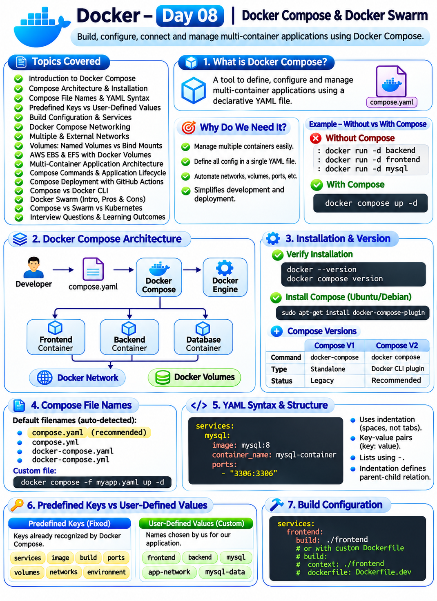
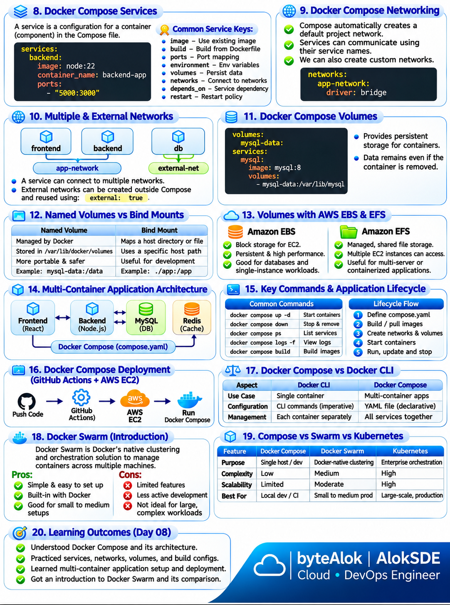

# 🐳 Day 08 – Docker Compose & Docker Swarm

> 🚀 Learning how to build, configure, connect, deploy, and manage multi-container applications using Docker Compose, followed by an introduction to Docker Swarm.

<p align="center">
  
  
</p>

# 📚 Table of Contents

| No. | Topics |
|---|---|
| 01 | 🐳 Introduction to Docker Compose |
| 02 | 🏗️ Docker Compose Architecture |
| 03 | ⚙️ Docker Compose Installation |
| 04 | 📄 Compose File Names |
| 05 | 📝 YAML Syntax and Structure |
| 06 | 🔑 Predefined Keys vs User-Defined Values |
| 07 | 🏗️ Docker Compose Build Configuration |
| 08 | 📦 Docker Compose Services |
| 09 | 🌐 Docker Compose Networking |
| 10 | 🔗 Multiple Networks |
| 11 | 🔌 External Networks |
| 12 | 💾 Docker Compose Volumes |
| 13 | 📂 Named Volumes vs Bind Mounts |
| 14 | ☁️ Docker Volumes with AWS EBS and EFS |
| 15 | 🏢 Multi-Container Application Architecture |
| 16 | ⌨️ Docker Compose Commands |
| 17 | 🔄 Docker Compose Application Lifecycle |
| 18 | ☁️ Docker Compose Deployment with GitHub Actions and AWS EC2 |
| 19 | ⚖️ Docker Compose vs Docker CLI |
| 20 | 🐝 Introduction to Docker Swarm |
| 21 | ✅ Advantages and ❌ Disadvantages of Docker Swarm |
| 22 | ⚔️ Docker Compose vs Docker Swarm vs Kubernetes |
| 23 | 🎯 Interview Questions |
| 24 | 🏆 Learning Outcomes |

---

# 01. 🐳 Introduction to Docker Compose

## 📖 What is Docker Compose?

Docker Compose is a container management and orchestration tool provided by Docker that allows developers and DevOps engineers to define, configure, create, start, stop, and manage multiple interconnected containers belonging to a single application using a declarative YAML configuration file.

In a traditional Docker workflow, each container is generally created and configured using separate Docker CLI commands. When an application consists of multiple components such as frontend, backend, databases, caching systems, and supporting services, managing each container individually becomes repetitive and difficult.

Docker Compose solves this problem by allowing us to describe the complete multi-container application in one configuration file, usually named `compose.yaml`.

Instead of manually executing multiple commands to create containers, configure networking, attach volumes, define environment variables, and publish ports, we declare these requirements in the Compose file. Docker Compose reads this configuration and communicates with Docker Engine to create and manage the required resources.

### 🎯 Why Do We Need Docker Compose?

Consider a real-world e-commerce application containing:

- 🖥️ Frontend — React application.
- ⚙️ Backend — Node.js / Express API.
- 🗄️ SQL Database — MySQL.
- 📦 NoSQL Database — MongoDB.
- ⚡ Cache — Redis.

Each component may require its own container, configuration, environment variables, network connectivity, and persistent storage.

Without Docker Compose, we would need to manage these components separately.

### ❌ Without Docker Compose

```bash
docker run -d --name backend-app backend-image

docker run -d --name frontend-app frontend-image

docker run -d --name mongodb-db mongo:8

docker run -d --name mysql-db mysql:8
```

We would also need to configure the required networks, volumes, port mappings, and environment variables.

### ✅ With Docker Compose

We define all services and their configurations inside one YAML file.

```bash
docker compose up -d
```

Docker Compose reads the configuration and manages the required application resources through Docker Engine.

### ⭐ Main Responsibilities of Docker Compose

| Feature | Description |
|---|---|
| 📦 Container Management | Creates, starts, stops, and removes application containers |
| 🏗️ Image Building | Builds custom images using Dockerfiles |
| 📥 Image Pulling | Downloads existing images from container registries |
| 🌐 Networking | Creates networks and connects services |
| 💾 Persistent Storage | Configures named volumes and bind mounts |
| 🔐 Environment Variables | Provides configuration values to containers |
| 🔗 Service Communication | Allows connected services to communicate using service names |
| 🔄 Lifecycle Management | Manages the application lifecycle through a single configuration |
| ⚙️ Configuration Management | Keeps application infrastructure configuration in a YAML file |

**Important:** Docker Compose is not a replacement for Docker Engine. Compose is the management layer that uses Docker Engine to perform container, image, network, and volume operations.

---

# 02. 🏗️ Docker Compose Architecture

## 📖 How Does Docker Compose Work?

Docker Compose works as an interface between the application's YAML configuration and Docker Engine.

It reads the `compose.yaml` file, interprets the declared services and their dependencies, and requests Docker Engine to create or manage the required resources.

Docker Engine performs the actual operations, such as creating containers, building images, creating networks, mounting volumes, and starting container processes.

### 🏗️ Architecture Diagram

```text
                 👨‍💻 Developer
                       |
                       |
                 📄 compose.yaml
                       |
                       |
                🐳 Docker Compose
                       |
                       |
                 ⚙️ Docker Engine
                       |
          +------------+------------+
          |            |            |
          |            |            |
      🖥️ Frontend  ⚙️ Backend  🗄️ Database
       Container    Container    Container
          |            |            |
          +------------+------------+
                       |
                 🌐 Docker Network
                       |
                 💾 Docker Volumes
```

### 🔄 Working Flow

1. 👨‍💻 Developer creates a `compose.yaml` configuration file.
2. 🐳 Docker Compose reads and validates the configuration.
3. ⚙️ Compose communicates with Docker Engine.
4. 🏗️ Docker Engine builds or pulls the required images.
5. 📦 Docker Engine creates the required containers.
6. 🌐 Required networks are created and attached.
7. 💾 Volumes are created and mounted.
8. 🚀 Application containers are started.

### 🧠 Important Components

| Component | Responsibility |
|---|---|
| `compose.yaml` | Defines the application's desired configuration |
| Docker Compose | Interprets and manages the Compose configuration |
| Docker Engine | Performs actual container and resource operations |
| Docker Images | Provide the application files and runtime environment |
| Containers | Run individual application services |
| Networks | Enable communication between connected containers |
| Volumes | Provide persistent storage |

---

# 03. ⚙️ Docker Compose Installation

## 📖 Is Docker Compose Included with Docker?

Docker Engine and Docker Compose are separate components.

Docker Compose V2 is distributed as a Docker CLI plugin. Docker Desktop includes Compose by default, whereas Linux installations may require installing the Compose plugin separately.

Therefore, after installing Docker Engine, we should verify whether Compose is already available.

### 🔍 Step 1: Verify Docker Installation

```bash
docker --version
```

Displays the installed Docker CLI version.

### 🔍 Step 2: Verify Docker Compose

```bash
docker compose version
```

Displays the Docker Compose plugin version if installed.

### 📥 Step 3: Install Compose Plugin on Ubuntu/Debian

Docker Engine and Docker's package repository should already be configured.

```bash
sudo apt-get update

sudo apt-get install docker-compose-plugin
```

### 📥 Step 4: Install Compose Plugin on RPM-Based Distributions

After configuring the appropriate Docker repository:

```bash
sudo yum update

sudo yum install docker-compose-plugin
```

For Amazon Linux 2023, use the appropriate Docker repository and package instructions.

### 🔍 Step 5: Verify Installation

```bash
docker compose version
```

Expected output will show the installed Compose V2 version.

### 🧠 Important Commands

```bash
docker --version

docker compose version

docker version

docker info
```

| Command | Purpose |
|---|---|
| `docker --version` | Checks Docker CLI version |
| `docker compose version` | Checks Compose plugin version |
| `docker version` | Displays Docker client and server versions |
| `docker info` | Displays Docker Engine configuration and information |

### ⚠️ Compose V1 vs Compose V2

| Compose V1 | Compose V2 |
|---|---|
| Legacy standalone implementation | Modern Docker CLI plugin |
| `docker-compose` | `docker compose` |
| Older Python-based implementation | Integrated Docker CLI plugin |
| Legacy naming and workflow | Current recommended approach |

**Recommendation:** Use Docker Compose V2 and the command `docker compose`.

---

# 04. 📄 Docker Compose File Names

Docker Compose uses a YAML file to describe the application's services, networks, volumes, and other configuration.

The preferred default filename is:

```text
compose.yaml
```

Other supported filenames are:

```text
compose.yml

docker-compose.yaml

docker-compose.yml
```

### 🔍 How Does Docker Compose Find the File?

When we execute:

```bash
docker compose up -d
```

Compose automatically looks for supported default Compose filenames in the current working directory and its applicable parent directories.

If a supported file is found, we do not need to specify its name using `-f`.

### 📌 Using a Custom Filename

Suppose we create:

```text
myapp.yaml
```

Docker Compose will not treat this arbitrary filename as one of the default names.

We must specify it explicitly:

```bash
docker compose -f myapp.yaml up -d
```

### 🔑 Understanding `-f`

`-f` is a predefined Docker Compose CLI option used to specify a Compose configuration file.

**Recommendation:** Use `compose.yaml` for new projects.

---

# 05. 📝 YAML Syntax and Structure

## 📖 What is YAML?

YAML stands for YAML Ain't Markup Language.

It is a human-readable data serialization language used to represent structured information through key-value pairs, lists, and nested objects.

Docker Compose uses YAML because it allows us to describe application services and their configurations in a readable and structured format.

Instead of writing a long sequence of Docker commands, we can declare the desired application configuration in a single YAML file.

### 🔍 Example

```yaml
services:
  mysql:
    image: mysql:8
    container_name: mysql-container
    ports:
      - "3306:3306"
```

### 🧩 Understanding the Syntax

| Syntax | Meaning |
|---|---|
| `services:` | Main configuration section |
| `mysql:` | User-defined service name |
| `image:` | Predefined key specifying the image |
| `mysql:8` | Image name and tag |
| `container_name:` | Predefined key specifying container name |
| `mysql-container` | User-defined container name |
| `ports:` | Predefined key for port mapping |
| `-` | YAML list item indicator |
| `"3306:3306"` | Host-to-container port mapping |

### 📐 YAML Indentation

YAML uses indentation to define the relationship between parent and child elements.

```yaml
services:                    # Level 1
  mysql:                     # Level 2
    image: mysql:8           # Level 3
    ports:                   # Level 3
      - "3306:3306"          # Level 4
```

### 🏗️ Understanding Nesting Levels

| Level | Description | Example |
|---|---|---|
| Top-level | Main section at the YAML root | `services`, `networks`, `volumes` |
| Service-level | Individual service configuration | `mysql`, `backend` |
| Configuration-level | Properties of a service or resource | `image`, `ports`, `driver` |
| List item | Individual element inside a YAML list | `- app-network` |

Top-level is an actual Compose/YAML structural term. The other labels are convenient ways to understand indentation and nesting.

### ⚠️ Important YAML Rules

- Use spaces for indentation.
- Do not use tabs.
- Maintain consistent indentation.
- Use `:` to separate keys and values.
- Use `-` to define list items.
- Quote values when appropriate, especially port mappings.
- Parent and child relationships are determined by indentation.

---

# 06. 🔑 Predefined Keys vs User-Defined Values

Understanding this distinction is essential when writing Docker Compose files.

## 📖 Predefined Keys

Predefined keys are configuration properties already recognized by Docker Compose.

They have a specific meaning and must use the correct spelling.

Examples:

```yaml
services:

image:

build:

container_name:

ports:

environment:

volumes:

networks:

driver:

external:
```

We cannot arbitrarily rename `image` to `myimage` or `ports` to `myports`.

## ✍️ User-Defined Names

User-defined names are names selected by us according to our application requirements.

Example:

```yaml
services:

  frontend:

  backend:

  mysql:

  mongodb:


networks:

  app-network:


volumes:

  mysql-data:

  mongo-data:
```

We can choose different service, network, and volume names.

### 📊 Difference

| Element | Type | Can We Rename It? |
|---|---|---|
| `services` | Predefined | No |
| `networks` | Predefined | No |
| `volumes` | Predefined | No |
| `image` | Predefined | No |
| `ports` | Predefined | No |
| `frontend` | User-defined | Yes |
| `backend` | User-defined | Yes |
| `app-network` | User-defined | Yes |
| `mysql-data` | User-defined | Yes |

### 🧠 Important Note

Some values are not Compose keys but belong to another application's configuration.

For example:

```yaml
environment:
  MYSQL_ROOT_PASSWORD: root123
  MYSQL_DATABASE: appdb
```

- `environment` is a Compose key.
- `MYSQL_ROOT_PASSWORD` and `MYSQL_DATABASE` are environment variable names supported by the official MySQL image.
- `root123` and `appdb` are values selected for this example.

---

# 07. 🏗️ Docker Compose Build Configuration

## 📖 What is Build Configuration?

Docker Compose can build custom Docker images directly from Dockerfiles.

Instead of manually running `docker build` for every application component, we can define the build configuration inside the Compose file.

Compose then uses the Docker build process to create the required images.

### 📁 Basic Project Structure

```text
my-application/
│
├── compose.yaml
│
├── frontend/
│   ├── Dockerfile
│   ├── package.json
│   └── src/
│
└── backend/
    ├── Dockerfile
    ├── package.json
    └── src/
```

### 🧩 Basic Build Syntax

```yaml
services:
  frontend:
    build: ./frontend

  backend:
    build: ./backend
```

Here:

- `build` is a predefined key.
- `./frontend` is the frontend build context.
- `./backend` is the backend build context.
- Compose looks for a file named `Dockerfile` by default within each context.

## 📂 Build Context vs Dockerfile Location

Build context and Dockerfile location are not necessarily the same.

Consider:

```text
my-application/
│
├── compose.yaml
│
├── docker/
│   └── frontend_Dockerfile
│
└── frontend/
    ├── package.json
    └── src/
```

Compose configuration:

```yaml
services:
  frontend:
    build:
      context: ./frontend
      dockerfile: ../docker/frontend_Dockerfile
```

### 🔍 Understanding the Configuration

| Key | Explanation |
|---|---|
| `build` | Defines image-building configuration |
| `context` | Specifies the directory available to the Docker build |
| `./frontend` | Frontend application directory |
| `dockerfile` | Specifies which Dockerfile to use |
| `../docker/frontend_Dockerfile` | Dockerfile path relative to the build context |

### 📌 Custom Dockerfile Filename

Suppose:

```text
frontend/
├── MyFrontendDockerfile
└── src/
```

Then:

```yaml
services:
  frontend:
    build:
      context: ./frontend
      dockerfile: MyFrontendDockerfile
```

### ⚠️ Important Build Context Rule

The build context determines which files are available during the image build.

Dockerfile instructions such as `COPY` normally access files from the build context, not arbitrary directories outside it.

Example:

```dockerfile
COPY . .
```

Copies the context contents into the image, subject to `.dockerignore`.

---

# 08. 📦 Docker Compose Services

## 📖 What is a Service?

A service in Docker Compose represents an application component that Compose manages according to a declared configuration.

A service describes how its container should be created and run, including its image or build source, ports, environment variables, networks, storage mounts, dependencies, and restart behavior.

A service is not simply another name for a container.

A service is the configuration and management definition; Compose creates one or more containers to implement it.

### 🔍 Example

```yaml
services:

  frontend:
    image: nginx:alpine
    container_name: frontend-container
    ports:
      - "3000:80"

  backend:
    image: node:22
    container_name: backend-container
    ports:
      - "5000:5000"
```

### 🔑 Important Service Keys

| Key | Purpose |
|---|---|
| `image` | Specifies an existing Docker image |
| `build` | Builds an image using a Dockerfile |
| `container_name` | Sets a specific container name |
| `ports` | Publishes container ports on the host |
| `environment` | Defines environment variables |
| `volumes` | Mounts storage into the container |
| `networks` | Connects the service to networks |
| `depends_on` | Defines service startup dependencies |
| `restart` | Defines the container restart policy |

## 🖼️ Image vs Build

### Existing Image

```yaml
mysql:
  image: mysql:8
```

Uses an existing image from a registry or local image store.

### Custom Image

```yaml
backend:
  build: ./backend
```

Builds an image from the Dockerfile in the specified build context.

## 🔌 Port Mapping

```yaml
ports:
  - "3000:80"
```

Format:

```text
HOST_PORT:CONTAINER_PORT
```

- Host port: `3000`
- Container port: `80`

The service can be accessed through the host's port 3000 if the application is listening on container port 80.

## 🔐 Environment Variables

```yaml
environment:
  DB_HOST: mysql
  DB_PORT: 3306
```

These are configuration values supplied to the application running inside the container.

Compose also supports list-style environment configuration:

```yaml
environment:
  - DB_HOST=mysql
  - DB_PORT=3306
```

The mapping and list forms are both valid.

---

# 09. 🌐 Docker Compose Networking

## 📖 What is Docker Compose Networking?

Docker Compose networking allows containers belonging to the same application to communicate with one another through Docker networks.

A multi-container application normally contains separate services. These services need a communication mechanism to exchange requests, send API calls, access databases, and interact with supporting components.

Compose simplifies this by automatically creating a default project network when no custom network configuration is specified.

Services connected to the same user-defined Compose network can communicate using their service names rather than requiring manually assigned IP addresses.

### 🔍 Default Network Example

```yaml
services:

  frontend:
    image: nginx:alpine

  backend:
    image: node:22

  mysql:
    image: mysql:8
```

Compose automatically creates a default network for the project and attaches its services.

### 🔎 Network Commands

```bash
docker network ls
```

Lists Docker networks.

```bash
docker network inspect <network_name>
```

Displays network configuration and connected containers.

## 🌐 Custom Bridge Network

A custom bridge network can be declared directly inside the Compose file.

```yaml
services:

  frontend:
    image: nginx:alpine
    networks:
      - app-network

  backend:
    image: node:22
    networks:
      - app-network

  mysql:
    image: mysql:8
    networks:
      - app-network


networks:
  app-network:
    driver: bridge
```

### 🧩 Understanding Network Configuration

Service-level configuration:

```yaml
networks:
  - app-network
```

This connects the service to `app-network`.

Top-level configuration:

```yaml
networks:
  app-network:
    driver: bridge
```

This declares the network and specifies the network driver.

| Element | Type | Meaning |
|---|---|---|
| `networks` | Predefined key | Network configuration |
| `app-network` | User-defined name | Network reference |
| `driver` | Predefined key | Network driver configuration |
| `bridge` | Docker driver value | Bridge network driver |

Compose creates the custom network when the application starts.

### 🔗 Service-to-Service Communication

If backend and MySQL are connected to the same Compose network, the backend can connect to MySQL using:

```text
mysql:3306
```

Similarly, MongoDB can be accessed using:

```text
mongodb:27017
```

The service names are resolved through Docker's network DNS.

### ⚠️ Important Difference

The default bridge network created by Docker Engine and user-defined bridge networks have different DNS behavior.

User-defined bridge networks provide automatic container-name resolution, whereas the legacy default bridge does not provide the same automatic name-resolution behavior.

---

# 10. 🔗 Multiple Networks

A single service can be connected to multiple Docker networks.

This is useful when an application requires network segmentation and isolation between different groups of services.

### 🧩 Example

```yaml
services:

  frontend:
    image: nginx:alpine
    networks:
      - frontend-network

  backend:
    image: node:22
    networks:
      - frontend-network
      - backend-network

  mysql:
    image: mysql:8
    networks:
      - backend-network


networks:
  frontend-network:
    driver: bridge

  backend-network:
    driver: bridge
```

### 🏗️ Network Architecture

```text
       🌐 FRONTEND NETWORK
       ===================

       🖥️ Frontend Container
                 |
                 |
       ⚙️ Backend Container
                 |
                 |
       ===================
        🗄️ BACKEND NETWORK
                 |
                 |
         🗄️ MySQL Container
```

### 🔍 Explanation

- Frontend belongs to `frontend-network`.
- Backend belongs to both networks.
- MySQL belongs to `backend-network`.
- Backend can communicate with frontend and MySQL.
- Frontend and MySQL do not share a common network.

### 📌 Multiple Network List

```yaml
networks:
  - frontend-network
  - backend-network
  - monitoring-network
```

This is a YAML list specifying the networks to which the service should be attached.

Each network must be declared in the top-level network configuration or configured as an external network.

---

# 11. 🔌 External Networks

## 📖 What is an External Network?

An external network is a Docker network that already exists independently of the current Compose project.

Docker Compose can connect application services to this existing network instead of creating and managing a new project network.

External networks are useful when multiple Compose projects need to communicate through the same shared Docker network.

### 🧩 Step 1: Create a Network Manually

```bash
docker network create shared-network
```

This creates a Docker network directly through Docker CLI.

### 🔍 Step 2: Verify

```bash
docker network ls
```

### 📝 Step 3: Configure Compose

```yaml
services:

  backend:
    image: node:22
    networks:
      - shared

  frontend:
    image: nginx:alpine
    networks:
      - shared


networks:
  shared:
    name: shared-network
    external: true
```

### 🔑 Understanding External Configuration

| Element | Explanation |
|---|---|
| `shared` | User-defined Compose network reference |
| `name` | Predefined key specifying actual network name |
| `shared-network` | Existing Docker network name |
| `external` | Predefined key |
| `true` | Boolean value indicating an external resource |

### 🔄 Execution Flow

```text
1. docker network create shared-network
                 |
                 v
2. Docker Engine creates network
                 |
                 v
3. Compose declares external: true
                 |
                 v
4. docker compose up -d
                 |
                 v
5. Services connect to existing network
```

### 🏢 Multiple Compose Projects

Consider two independent projects:

```text
Project-1/
    compose.yaml
    Backend
    MySQL

Project-2/
    compose.yaml
    Frontend
    Nginx
```

Both projects can use the same externally created network.

This allows services attached to that shared network to communicate across project boundaries.

### 🧹 External Network Cleanup

```bash
docker network inspect shared-network

docker network rm shared-network
```

Compose does not remove an external network when running `docker compose down`.

The network must not be in use when removing it.

---

# 12. 💾 Docker Compose Volumes

## 📖 What are Docker Volumes?

Docker volumes are a persistent storage mechanism used to store application data independently of a container's writable layer.

Containers have their own writable filesystem layer. However, data stored only in this layer is tied to the container lifecycle and is normally removed when the container is removed.

This becomes a problem for stateful applications such as MySQL and MongoDB because database files must survive container replacement, recreation, and updates.

Docker volumes solve this problem by storing data outside the container's writable layer and mounting that storage into the container at a specified directory.

The container accesses the mounted storage through its internal filesystem path, while the actual volume data remains on the Docker host.

### 🧩 Basic Named Volume Configuration

```yaml
services:
  mysql:
    image: mysql:8
    volumes:
      - mysql-data:/var/lib/mysql


volumes:
  mysql-data:
```

### 🔍 Understanding the Configuration

Service-level:

```yaml
volumes:
  - mysql-data:/var/lib/mysql
```

- `mysql-data` is the named volume.
- `/var/lib/mysql` is the container's MySQL data directory.
- The volume is mounted at that container path.

Top-level:

```yaml
volumes:
  mysql-data:
```

This declares the named volume so Compose can create and manage it.

### 🏗️ Storage Architecture

```text
            🖥️ DOCKER HOST
                   |
                   |
        💾 Docker Named Volume
              mysql-data
                   |
                   |
              Mount Point
                   |
                   v
           📦 MYSQL CONTAINER
                   |
                   |
             /var/lib/mysql
                   |
                   |
           🗄️ Database Files
```

### 📂 Default Linux Volume Location

Docker Engine commonly stores named volumes under:

```text
/var/lib/docker/volumes/
```

Example:

```text
/var/lib/docker/volumes/mysql-data/_data/
```

Compose-generated volume names may include the project name.

The actual Docker data root can be customized, so this path is not guaranteed for every installation.

### 🔍 Volume Commands

```bash
docker volume ls
```

Lists volumes.

```bash
docker volume create volume1
```

Creates a volume manually.

```bash
docker volume inspect volume1
```

Displays volume details.

```bash
docker volume rm volume1
```

Removes an unused volume.

```bash
docker volume prune
```

Removes unused volumes according to Docker's pruning behavior.

---

# 13. 📂 Named Volumes vs Bind Mounts

Docker supports different methods of connecting host storage to containers.

## A. 💾 Named Volumes

Named volumes are storage resources managed by Docker.

```yaml
services:
  mysql:
    image: mysql:8
    volumes:
      - mysql-data:/var/lib/mysql


volumes:
  mysql-data:
```

### Characteristics

- Docker manages their storage location.
- Data is stored on the Docker host.
- Containers access the data through mount points.
- Data normally survives container removal.
- Suitable for persistent database and application data.

## B. 📁 Bind Mounts

Bind mounts connect a specific directory or file on the host filesystem to a location inside a container.

Unlike named volumes, the host path is explicitly selected by the user.

### Example

```yaml
services:
  mysql:
    image: mysql:8
    volumes:
      - /data/mysql:/var/lib/mysql
```

### Understanding the Paths

| Path | Location |
|---|---|
| `/data/mysql` | EC2 host filesystem |
| `/var/lib/mysql` | Container filesystem |

### Create Host Directory

```bash
sudo mkdir -p /data/mysql
```

### Start Application

```bash
docker compose up -d
```

### 🆚 Named Volumes vs Bind Mounts

| Feature | Named Volume | Bind Mount |
|---|---|---|
| Storage location | Docker-managed host location | User-selected host path |
| Management | Docker | User/host |
| Persistence | Yes | Yes |
| Host path control | Docker-managed | Explicitly configured |
| Common use | Database storage | Configuration and host-managed files |

### ⚠️ Container Removal and Persistence

Without a volume:

```text
Container
   |
   v
Writable Layer
   |
   v
Container Removed
   |
   v
Data Lost
```

With a named volume:

```text
Container
   |
   v
Mounted Named Volume
   |
   v
Container Removed
   |
   v
Volume Remains
   |
   v
Data Persists
```

**Important:** A normal `docker compose down` does not remove declared named volumes. However, `docker compose down -v` can remove them and their stored data.

---

# 14. ☁️ Docker Volumes with AWS EBS and EFS

Docker storage can also use AWS-provided storage.

Understanding the difference between Docker-managed storage and AWS storage is important for production deployments.

## A. 🖥️ EC2 Root Disk + Docker Named Volume

An EC2 instance normally uses an EBS-backed disk for its root filesystem.

If Docker's data directory is stored on this filesystem, Docker named volumes are also stored on that disk.

### Architecture

```text
                 ☁️ AWS
                   |
                   v
                🖥️ EC2
                   |
                   v
              💽 Root EBS
                   |
                   v
           Linux Filesystem
                   |
                   v
       /var/lib/docker/volumes/
                   |
                   v
          💾 Named Volume
                   |
                   v
            🗄️ MySQL Container
```

The named volume is stored on the EC2 host filesystem, not physically inside the container.

## B. 💽 Additional EBS + Bind Mount

An additional EBS volume can be attached to EC2 and mounted at a directory such as:

```text
/data
```

Then a directory inside that filesystem can be bind-mounted into the container.

### Compose Configuration

```yaml
services:
  mysql:
    image: mysql:8
    volumes:
      - /data/mysql:/var/lib/mysql
```

### Storage Architecture

```text
          ☁️ AWS EBS
               |
               v
           🖥️ EC2
               |
               v
       📂 /data/mysql
               |
               v
       📦 MySQL Container
               |
               v
        /var/lib/mysql
```

### Important Operations

EBS attachment and filesystem mounting are separate AWS/Linux operations.

They can be automated using:

- AWS EC2 configuration.
- User-data/cloud-init scripts.
- Ansible.
- CI/CD deployment scripts.

Docker Compose does not automatically provision or attach an EBS volume.

## C. 🌐 Amazon EFS + Bind Mount

Amazon EFS is a managed network file system that can be accessed by multiple EC2 instances when the required network connectivity and permissions are configured.

### Architecture

```text
                 ☁️ AWS EFS
                     |
             +-------+-------+
             |               |
             v               v
           🖥️ EC2-1        🖥️ EC2-2
             |               |
             v               v
          /mnt/efs         /mnt/efs
             |               |
             v               v
         📦 Container     📦 Container
```

### Compose Configuration

If EFS is mounted on EC2 at `/mnt/efs`:

```yaml
services:
  backend:
    image: node:22
    volumes:
      - /mnt/efs:/app/shared-files
```

| Path | Meaning |
|---|---|
| `/mnt/efs` | EFS-mounted host directory |
| `/app/shared-files` | Container mount point |

**Important:** EFS must first be mounted on the EC2 host. Compose uses the existing host directory as a bind mount.

EFS is useful for shared application files and uploads. Database storage requires separate compatibility and performance checks before using EFS for database data directories.

### 📊 Storage Comparison

| Storage | Location | Common Purpose |
|---|---|---|
| Container writable layer | Container filesystem | Temporary changes |
| Named Volume | Docker host | Persistent container data |
| Bind Mount | Selected host directory | Host-managed files |
| EBS | AWS block storage attached to EC2 | Persistent disk |
| EFS | AWS network file system | Shared files across instances |

### 🛡️ Data Persistence

| Situation | Result |
|---|---|
| Container removed, named volume retained | Data remains |
| Container removed, bind-mounted folder retained | Data remains |
| EC2 terminated, root EBS deleted | Data may be lost |
| Separate EBS retained | Can be reattached to another compatible EC2 |
| EFS retained | Data remains independently of EC2 |

Always combine persistent storage with backup and recovery planning.

---

# 15. 🏢 Multi-Container Application Architecture

Now combine services, networks, volumes, and build configuration into one application.

### 🧩 Application Components

| Component | Technology | Responsibility |
|---|---|---|
| 🖥️ Frontend | React / Nginx | User interface |
| ⚙️ Backend | Node.js / Express | API and business logic |
| 🗄️ SQL Database | MySQL | Relational data |
| 📦 NoSQL Database | MongoDB | Document-oriented data |
| 🌐 Network | Custom Bridge | Container communication |
| 💾 Storage | Named Volumes | Persistent database storage |

### 🏗️ Architecture

```text
                   🌍 USER
                     |
                     v
               🖥️ FRONTEND
                  Container
                     |
                     v
                ⚙️ BACKEND
                  Container
                     |
             +-------+-------+
             |               |
             v               v
        🗄️ MYSQL          📦 MONGODB
        Container          Container
             |               |
             v               v
        💾 Volume          💾 Volume
```

All four services can be connected through the same custom bridge network.

### 📝 Complete Compose Configuration

```yaml
services:

  frontend:
    build: ./frontend
    container_name: frontend-container
    ports:
      - "3000:3000"
    networks:
      - app-network

  backend:
    build: ./backend
    container_name: backend-container
    ports:
      - "5000:5000"
    environment:
      DB_HOST: mysql
      DB_PORT: 3306
      MONGO_HOST: mongodb
      MONGO_PORT: 27017
    networks:
      - app-network

  mysql:
    image: mysql:8
    container_name: mysql-container
    environment:
      MYSQL_ROOT_PASSWORD: root123
      MYSQL_DATABASE: appdb
    volumes:
      - mysql-data:/var/lib/mysql
    networks:
      - app-network

  mongodb:
    image: mongo:8
    container_name: mongodb-container
    environment:
      MONGO_INITDB_ROOT_USERNAME: admin
      MONGO_INITDB_ROOT_PASSWORD: mongo123
    volumes:
      - mongo-data:/data/db
    networks:
      - app-network


networks:
  app-network:
    driver: bridge


volumes:
  mysql-data:
  mongo-data:
```

### 🔍 Configuration Breakdown

| Configuration | Purpose |
|---|---|
| `services` | Defines application components |
| `frontend` | Frontend service |
| `backend` | Backend service |
| `mysql` | SQL database service |
| `mongodb` | NoSQL database service |
| `build` | Builds custom application images |
| `image` | Uses official database images |
| `container_name` | Assigns container names |
| `ports` | Publishes application ports |
| `environment` | Provides application/database configuration |
| `volumes` | Mounts persistent storage |
| `networks` | Connects services |
| `driver: bridge` | Selects bridge network driver |

### 🔄 Request Flow

1. 🌍 User opens the frontend application in a browser.
2. 🖥️ Frontend sends a request to the backend API.
3. ⚙️ Backend processes the request.
4. 🗄️ Backend accesses MySQL or MongoDB as required.
5. 💾 Database reads or updates persistent data.
6. ⚙️ Backend sends the response to frontend.
7. 🖥️ Frontend displays the result to the user.

### ⚠️ Browser Networking

A browser running outside Docker cannot resolve internal Compose service names such as `backend`.

For local access, it can use a published host port such as:

```text
http://localhost:5000
```

An Nginx reverse proxy can also route requests to the backend through Docker's internal network.

**Production Note:** The example credentials are for learning only. Production deployments should use secrets, strong credentials, appropriate health checks, and secure configuration. Application images must also contain the actual application code and appropriate Dockerfiles.

---

# 16. ⌨️ Docker Compose Commands

Docker Compose provides a CLI to manage the complete lifecycle of multi-container applications.

## A. 🔍 Version and Configuration

| Command | Purpose |
|---|---|
| `docker compose version` | Displays Compose version |
| `docker compose config` | Validates and displays resolved configuration |
| `docker compose config --services` | Lists configured services |
| `docker compose config --volumes` | Lists declared volumes |
| `docker compose config --networks` | Lists declared networks |
| `docker compose config -q` | Validates configuration without printing it |

## B. 🏗️ Create, Build, Pull and Run

```bash
docker compose create
```

Creates service containers without starting them.

```bash
docker compose build
```

Builds service images.

```bash
docker compose build backend
```

Builds a specific service image.

```bash
docker compose pull
```

Pulls configured service images from registries.

```bash
docker compose up
```

Creates and starts application services.

```bash
docker compose up -d
```

Starts services in detached mode.

```bash
docker compose up -d --build
```

Builds required images and starts services.

```bash
docker compose up --force-recreate -d
```

Forces container recreation.

```bash
docker compose run --rm backend npm test
```

Creates a one-off container, executes a command, and removes that container after completion.

## C. 📊 Check Running Services

| Command | Purpose |
|---|---|
| `docker compose ps` | Lists project containers |
| `docker compose ps -a` | Includes stopped containers |
| `docker compose ls` | Lists Compose projects |
| `docker compose images` | Lists project images |
| `docker compose top` | Displays running processes |
| `docker compose stats` | Displays resource usage |
| `docker compose port backend 5000` | Shows published port mapping |

## D. 📜 Logs and Container Access

```bash
docker compose logs
```

Displays logs from all services.

```bash
docker compose logs backend
```

Displays backend logs.

```bash
docker compose logs -f backend
```

Continuously follows backend logs.

```bash
docker compose exec backend bash
```

Opens a Bash shell in a running backend container.

```bash
docker compose exec backend sh
```

Opens a shell when Bash is unavailable.

```bash
docker compose exec mysql mysql -uroot -p
```

Opens the MySQL client inside the MySQL container.

## E. ⏹️ Stop, Start, Restart and Pause

| Command | Purpose |
|---|---|
| `docker compose stop` | Stops running containers without removing them |
| `docker compose stop backend` | Stops a specific service |
| `docker compose start` | Starts previously created stopped containers |
| `docker compose restart` | Restarts services |
| `docker compose restart mysql` | Restarts a specific service |
| `docker compose pause` | Pauses service processes |
| `docker compose unpause` | Resumes paused services |
| `docker compose kill` | Forcefully terminates containers |

### 🔍 Important Differences

- `stop` — stops containers but keeps them.
- `start` — starts existing stopped containers.
- `restart` — restarts containers.
- `pause` — freezes container processes temporarily.
- `kill` — forcefully terminates container processes.

## F. 🔄 Update and Rebuild

```bash
docker compose build backend
```

Rebuilds the backend image.

```bash
docker compose up -d backend
```

Applies the updated service configuration and starts the backend.

```bash
docker compose up -d --build
```

Builds updated images and starts the application.

```bash
docker compose pull
```

Pulls updated images from registries.

```bash
docker compose up -d
```

Starts services using the updated images.

**Important:** `docker compose restart` does not rebuild images after Dockerfile changes.

## G. 🗑️ Remove and Cleanup

| Command | Purpose |
|---|---|
| `docker compose rm` | Removes stopped service containers |
| `docker compose rm -f` | Removes stopped containers without confirmation |
| `docker compose down` | Stops and removes project containers and managed networks |
| `docker compose down -v` | Also removes declared named and anonymous volumes |
| `docker compose down --rmi all` | Also removes associated service images |

⚠️ **Warning:** `docker compose down -v` can permanently delete database data stored in Compose-managed named volumes.

External networks and external volumes are not removed by Compose.

## H. 📂 Copy Files

```bash
docker compose cp backend:/app/logs ./logs
```

Copies files from the container to the host.

```bash
docker compose cp ./config.json backend:/app/config.json
```

Copies files from the host into the container.

## I. 🚀 Additional Commands

| Command | Purpose |
|---|---|
| `docker compose events` | Displays real-time Compose events |
| `docker compose attach backend` | Attaches to a running service's streams |
| `docker compose wait` | Waits for service containers to stop |
| `docker compose watch` | Watches source changes and performs configured actions |
| `docker compose push` | Pushes configured images to a registry |

Some commands require particular Compose versions or service configuration.

---

# 17. 🔄 Docker Compose Application Lifecycle

A typical development and deployment lifecycle can be represented as follows.

### Step 1 — Validate Configuration

```bash
docker compose config
```

Checks YAML configuration and displays the resolved configuration.

### Step 2 — Build Images

```bash
docker compose build
```

Builds custom application images.

### Step 3 — Create and Start Containers

```bash
docker compose up -d
```

Creates required resources and starts application services.

### Step 4 — Check Containers

```bash
docker compose ps
```

Checks running and stopped containers.

### Step 5 — Check Logs

```bash
docker compose logs -f
```

Follows application logs.

### Step 6 — Update Application

```bash
docker compose up -d --build
```

Rebuilds images and applies updated configuration.

### Step 7 — Stop Application

```bash
docker compose stop
```

Stops services without removing containers.

### Step 8 — Start Again

```bash
docker compose start
```

Starts previously stopped containers.

### Step 9 — Cleanup

```bash
docker compose down
```

Stops and removes project containers and managed networks.

---

# 18. ☁️ Docker Compose Deployment with GitHub Actions and AWS EC2

## 📖 How Does Docker Compose Work in a CI/CD Pipeline?

Docker Compose can be used to deploy and manage multi-container applications on an AWS EC2 instance.

For this setup, Docker Engine and the Docker Compose plugin must be available on the machine whose Docker Engine will run the application.

The Compose configuration file must also be available to the deployment environment.

### 🧩 Required EC2 Components

- 🐧 Linux operating system.
- 🐳 Docker Engine.
- ⚙️ Docker Compose plugin.
- 📄 `compose.yaml`.
- 🔐 Application environment configuration.
- 📦 Required images or Docker build files.

Docker installation can be automated using Ansible, cloud-init, or shell scripts.

## 🏗️ Case A — GitHub-hosted Runner with SSH Deployment

```text
              🧑‍💻 Developer
                    |
                    v
            📦 GitHub Repository
                    |
                    v
             ⚙️ GitHub Actions
              Hosted Runner
                    |
                    v
              🧪 Build & Test
                    |
                    v
            📤 Push Docker Images
                    |
                    v
              🔐 SSH Connection
                    |
                    v
                ☁️ AWS EC2
                    |
                    v
             🐳 Docker Engine
                    |
                    v
             📄 Docker Compose
                    |
          +---------+---------+
          |         |         |
          v         v         v
       Frontend  Backend  Databases
       Container Container Containers
```

### 🔄 Deployment Flow

1. Developer pushes application code to GitHub.
2. GitHub Actions starts a workflow on a GitHub-hosted runner.
3. The workflow builds and tests the application.
4. Docker images can be pushed to a container registry.
5. The workflow establishes an SSH connection to EC2.
6. Deployment commands execute on EC2.
7. Docker Compose pulls updated images and starts the application.

### 🚀 Example EC2 Deployment Commands

```bash
docker compose pull

docker compose up -d
```

### ⚠️ Important Difference

If `docker compose up` runs on a GitHub-hosted runner, containers are created on that runner's Docker Engine.

They do not automatically run on EC2.

For EC2 deployment, Compose commands must execute on EC2 or target its Docker Engine remotely.

## 🏗️ Case B — Self-hosted GitHub Actions Runner on EC2

EC2 can also be configured as a self-hosted GitHub Actions runner.

```text
           📦 GitHub Repository
                    |
                    v
                ☁️ AWS EC2
                    |
          +---------+---------+
          |                   |
          v                   v
     GitHub Actions       Docker Engine
     Self-hosted Runner       |
          |                   |
          v                   |
     docker compose up -d ----+
                    |
                    v
             📦 Application
               Containers
```

Example workflow:

```yaml
jobs:
  deploy:
    runs-on: self-hosted

    steps:
      - name: Checkout
        uses: actions/checkout@v4

      - name: Deploy
        run: docker compose up -d --build
```

In this case, the workflow executes directly on the EC2 machine hosting the self-hosted runner.

---

# 19. ⚖️ Docker Compose vs Docker CLI

| Feature | Docker CLI | Docker Compose |
|---|---|---|
| Container Management | Individual commands | Multiple services together |
| Configuration | Command-line arguments | YAML configuration |
| Networking | Manual commands | Declarative network configuration |
| Volumes | Manual creation and mounting | Declarative volume configuration |
| Application Startup | Separate commands | Single `up` command |
| Application Cleanup | Separate commands | Single `down` command |
| Main Purpose | Managing Docker resources | Managing multi-container applications |

Docker Compose uses Docker Engine to perform the actual container and resource operations.

---

# 20. 🐝 Introduction to Docker Swarm

## 📖 What is Docker Swarm?

Docker Swarm is Docker's built-in container orchestration solution that allows multiple Docker Engine hosts to work together as a single cluster.

In a normal single-host Docker environment, containers run on one Docker host. If that host becomes unavailable, the application running on it may also become unavailable.

Docker Swarm addresses this limitation by grouping multiple Docker hosts into a cluster and managing application services across those hosts.

It allows administrators to define the desired state of an application, such as the number of replicas required, and Swarm attempts to maintain that state by scheduling and managing service tasks across available nodes.

Docker Swarm also provides service discovery, load balancing, service scaling, and node management.

### 🏗️ Basic Architecture

```text
             🐝 DOCKER SWARM CLUSTER
                       |
              +--------+--------+
              |                 |
              v                 v
        👑 MANAGER NODE     👷 WORKER NODE
              |                 |
              v                 v
        Frontend Service    Backend Service
              |                 |
              v                 v
        Application Tasks   Application Tasks
```

### 🔍 What Does Docker Swarm Do?

- 🏢 Combines multiple Docker hosts into one cluster.
- 👑 Uses manager nodes to manage the cluster.
- 👷 Uses worker nodes to run assigned workloads.
- 📦 Deploys services across cluster nodes.
- 🔢 Supports service scaling and replicas.
- ⚖️ Provides built-in service routing and load balancing.
- 🔄 Attempts to maintain the desired number of service replicas.
- 🔍 Provides service discovery between cluster services.

### ⚙️ Is Docker Swarm Installed Separately?

No separate orchestration platform installation is required.

Swarm functionality is built into Docker Engine.

However, the Docker Engine hosts must be configured and Swarm must be initialized before using a cluster.

**For this learning stage, we only cover the introduction and purpose of Swarm. Detailed Swarm practicals are outside the scope of this Docker course.**

---

# 21. ✅ Advantages and ❌ Disadvantages of Docker Swarm

## ✅ Advantages

### 1. Easy to Learn
Docker Swarm has a relatively simple architecture and a smaller learning curve compared with Kubernetes.

### 2. Built into Docker Engine
Swarm functionality is already available in Docker Engine, so a separate orchestration platform is not required.

### 3. Easy Cluster Setup
Multiple Docker hosts can be joined together to form a cluster.

### 4. Service Scaling
Services can be scaled by increasing or decreasing the number of replicas.

### 5. Built-in Load Balancing
Swarm provides service routing and load balancing across service tasks.

### 6. High Availability
Services can be distributed across multiple nodes to improve application availability.

### 7. Desired State Management
Swarm attempts to maintain the specified number of service replicas.

## ❌ Disadvantages

### 1. Smaller Ecosystem
Docker Swarm has a smaller ecosystem and community compared with Kubernetes.

### 2. Fewer Advanced Capabilities
It offers fewer advanced orchestration and customization capabilities than Kubernetes.

### 3. Limited Extensibility
Its ecosystem provides fewer extension and integration options.

### 4. Lower Industry Adoption
Kubernetes has significantly broader adoption in modern container orchestration environments.

### 5. Complex Production Requirements
Large and complex environments may benefit from Kubernetes' broader orchestration features and ecosystem.

## 🤔 Why Do Many Organizations Choose Kubernetes?

Kubernetes provides:

- A broader ecosystem.
- Extensive extensibility.
- Advanced workload orchestration.
- Rich configuration and deployment capabilities.
- Wider industry adoption.
- A large collection of integrations and supporting tools.

However, Docker Swarm is not useless or automatically deprecated. It can still be a practical choice for simpler cluster requirements.

---

# 22. ⚔️ Docker Compose vs Docker Swarm vs Kubernetes

| Feature | Docker Compose | Docker Swarm | Kubernetes |
|---|---|---|---|
| Main Purpose | Multi-container management | Cluster orchestration | Advanced container orchestration |
| Environment | Mainly one Docker host | Multiple Docker hosts | Multiple cluster nodes |
| Scaling | Service replicas on a host | Cluster-wide service scaling | Advanced workload scaling |
| Service Discovery | Compose network DNS | Built-in service discovery | Kubernetes service discovery |
| Load Balancing | Not a cluster load balancer | Built-in service routing | Services and ingress ecosystem |
| Self-healing | Limited to container restart behavior | Service reconciliation | Advanced reconciliation |
| Complexity | Low | Medium | High |
| Ecosystem | Compose ecosystem | Smaller ecosystem | Large ecosystem |
| Common Usage | Development and smaller deployments | Simpler container clusters | Production container platforms |

### 🚀 DevOps Learning Journey

```text
🐳 DOCKER
    |
    v
📦 Docker Images & Containers
    |
    v
🏗️ Dockerfile
    |
    v
🌐 Docker Networking
    |
    v
💾 Docker Volumes
    |
    v
⚙️ Docker Compose
    |
    v
🐝 Docker Swarm Introduction
    |
    v
☸️ KUBERNETES
```

---

# 23. 🎯 Interview Questions

### 1. What is Docker Compose?

Docker Compose is a tool used to define and manage multi-container applications using a YAML configuration file. It allows us to configure services, networking, volumes, and other application resources in one place.

### 2. Why do we use Docker Compose?

It simplifies multi-container application management by allowing us to create, configure, start, stop, update, and remove multiple application services through a single configuration.

### 3. Is Docker Compose included with Docker Engine?

Docker Engine and Compose are separate components. Docker Desktop includes Compose, while Linux installations may require installing the Compose plugin separately.

### 4. What is the default Docker Compose filename?

`compose.yaml` is the preferred filename. Other supported names include `compose.yml`, `docker-compose.yaml`, and `docker-compose.yml`.

### 5. What is the difference between `image` and `build`?

`image` specifies an existing image, whereas `build` defines how to build a custom image using a Dockerfile.

### 6. What is the difference between `context` and `dockerfile`?

`context` specifies the files available during the Docker build, whereas `dockerfile` specifies which Dockerfile should be used.

### 7. Does Docker Compose automatically create networks?

Yes. Compose normally creates a default project network if no custom network configuration is provided.

### 8. What is the purpose of `external: true`?

It tells Compose to reuse an existing external resource rather than creating and managing it as a project resource.

### 9. What is the difference between named volumes and bind mounts?

Named volumes are managed by Docker, whereas bind mounts connect a specific host filesystem path to a container path.

### 10. What happens to named volumes after `docker compose down`?

Declared named volumes normally remain unless the `-v` option is used.

### 11. What is the difference between `docker compose stop` and `docker compose down`?

`stop` stops containers without removing them, whereas `down` stops and removes project containers and Compose-managed networks.

### 12. What is Docker Swarm?

Docker Swarm is Docker's built-in container orchestration solution that manages application services across multiple Docker hosts in a cluster.

---

# 24. 🏆 Learning Outcomes

After completing Docker and Docker Compose, I have covered:

### 🐳 Docker Fundamentals
- Docker architecture.
- Docker images and containers.
- Docker Hub and image management.
- Container lifecycle and execution.
- Dockerfile and custom image building.

### 🏗️ Docker Image Building
- Dockerfile instructions.
- RUN vs CMD.
- Build context.
- Custom Dockerfile names.
- Port mapping.
- Multi-stage builds.
- Maven and SonarQube integration concepts.

### 🌐 Docker Networking
- Default bridge network.
- None network.
- Host network.
- Custom bridge networks.
- Container-to-container communication.
- Multiple network attachment.
- External networks.

### 💾 Docker Storage
- Docker volumes.
- Named volumes.
- Bind mounts.
- Persistent container storage.
- EBS storage integration.
- EFS storage integration.

### ⚙️ Docker Compose
- Compose installation.
- YAML syntax and structure.
- Predefined and user-defined keys.
- Compose file naming.
- Dockerfile build configuration.
- Multi-container applications.
- Service networking.
- Volume configuration.
- Compose lifecycle commands.
- GitHub Actions and AWS EC2 deployment architecture.

### 🐝 Docker Swarm
- Introduction to container orchestration.
- Cluster architecture.
- Manager and worker concepts.
- Advantages and disadvantages.
- Comparison with Kubernetes.

---

## 📚 Official Documentation

- 🐳 [Docker Documentation](https://docs.docker.com/)
- ⚙️ [Docker Compose Documentation](https://docs.docker.com/compose/)
- 📝 [Compose File Reference](https://docs.docker.com/reference/compose-file/)
- 🌐 [Docker Networking](https://docs.docker.com/engine/network/)
- 💾 [Docker Volumes](https://docs.docker.com/engine/storage/volumes/)
- 🐝 [Docker Swarm](https://docs.docker.com/engine/swarm/)

---

---

## 🤝 Let's Connect

👨‍💻 **GitHub:** [@byteAlok](https://github.com/byteAlok)

🌐 **Portfolio:** [aloksde.com](https://aloksde.com)

🐳 **Docker Journey Completed!**

With Docker, Dockerfile, Networking, Volumes, Multi-Stage Builds, and Docker Compose, this marks the completion of my Docker learning journey.

☸️ **Next Stop: Kubernetes!**

Moving forward to the next major stage of my DevOps engineering journey — **Kubernetes**, where I'll explore container orchestration, cluster management, scaling, deployment, and production-level workloads.

🚀 **Continue the Journey:** [Explore My Kubernetes Repository](https://github.com/byteAlok/Kubernetes)

⭐ If you found these notes helpful, consider giving this repository a **Star**. Your support motivates me to keep learning, documenting, and sharing practical knowledge.

**Thank you for being part of this journey! See you in the Kubernetes chapter. Happy Learning & Keep Building! 🚀**

